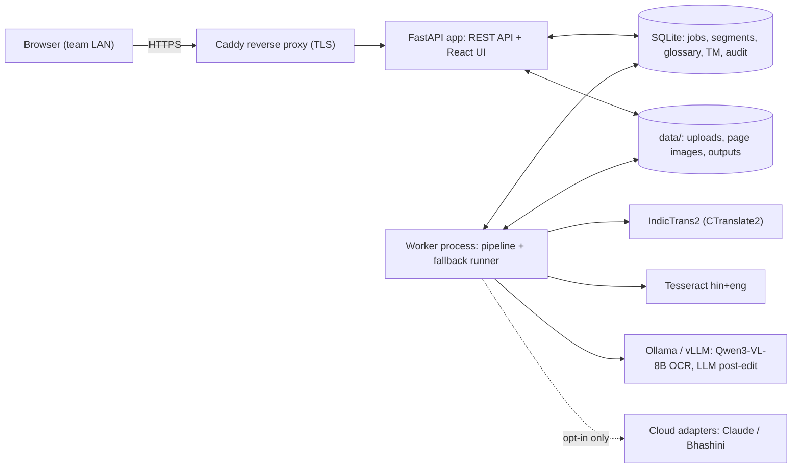
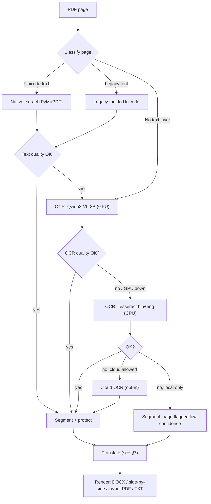
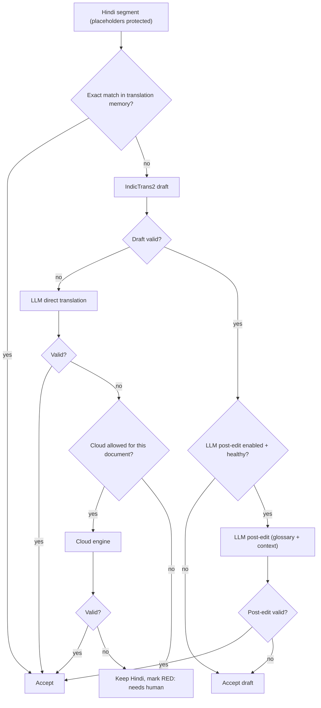

# Hindi PDF Translator: Project Plan

> **Request (Vikram Chandra):** We get many documents from Beltron, all in Hindi. We need a small web page where anyone on the team can upload a PDF and get it translated. Today this is done by hand with Copilot, which sometimes won't accept the upload.
>
> **Added requirements:** it runs **locally** (our own machine and network), it has **fallbacks**, and the translation quality is the **best available**.

| | |
|---|---|
| Status | Draft v1, for review |
| Date | 2026-10-11 |
| Scope | Hindi (including Hindi mixed with English) to English. The design leaves room for English to Hindi and other Indian languages later. |

---

## 1. Summary

- **What we build:** an internal web app that runs on one office workstation. Users drag in a PDF, watch its progress, review the English side by side with the original, and download a Word file, a PDF that keeps the original layout, or plain text.
- **Local by default:** every model runs on our hardware. After installation no document leaves the network. The cloud is an optional last fallback. It is off by default, and a user has to allow it for each document.
- **Translation engine:** **IndicTrans2** produces a first translation. It is the strongest open-source Hindi-to-English model in the published comparisons we found, and it has an MIT licence. A **local LLM** then edits that draft to use document context, our government terminology glossary and natural English. A validator checks each sentence before we accept it.
- **The OCR and text-extraction step matters most.** Bihar government PDFs often use legacy fonts such as Kruti Dev, or are scans, and in both cases plain copy-paste gives gibberish. Most quality problems start there, so the pipeline sorts pages by type and uses a different extraction method for each.
- **Fallbacks at every step:** each stage has 2–4 engines. A job always finishes. In the worst case one sentence is marked "needs human review". A document is never just reported as failed.
- **"Best in market" is something we measure:** before choosing the defaults, we run a blind test on 30–50 real Beltron documents against today's Copilot output. Engines are plug-ins, so changing one is a config change.
- **Timeline for one developer:** a working MVP in about 2 weeks, ready for production in about 6–7 weeks.

---

## 2. Requirements

### Functional

| ID | Requirement |
|---|---|
| F1 | Upload one or more PDFs by drag and drop. Default limits are 50 MB and 200 pages per file, both configurable. |
| F2 | Translate Hindi, including code-mixed Hindi and English, into English. |
| F3 | Outputs: **editable Word (.docx)**, **side-by-side web view**, **PDF with the original layout**, and plain text. |
| F4 | Show progress page by page, list jobs, and keep a history of past translations. |
| F5 | Let users review and correct individual sentences. Approved corrections are reused automatically next time (translation memory). |
| F6 | A shared glossary for the team, for example ज्ञापांक → "Memo No." and कार्यादेश → "Work Order". |

### Non-functional

| ID | Requirement |
|---|---|
| N1 | **Local:** runs on our own premises and works with no internet after installation. |
| N2 | **Fallback:** no single failure (a crashed model, a full GPU, a bad scan or a strange font) stops a translation. |
| N3 | **Quality:** in a blind review, preferred over the current Copilot output. **No errors in numbers, dates or reference numbers.** |
| N4 | **Privacy:** login, automatic deletion after N days, and an audit log of which engine processed which document. |
| N5 | **Easy to run:** started with one `docker compose up`, and its health is visible on an admin page. |

### Assumptions (to be confirmed)

- Volume of 5–50 documents a day, usually 1–30 pages each, used by about 5–20 people.
- Document types: letters, office orders, tenders, RFPs and corrigenda, work orders, empanelment notices and minutes. Many contain **tables, stamps, signatures and handwritten notes**.
- A mix of digitally created PDFs and scans.

### Open questions for Vikram and the team

1. What are the actual volume and typical page counts?
2. Is cloud processing **ever** allowed, for example for non-confidential documents with a user's approval? Or must everything stay local?
3. Is there a machine with an NVIDIA GPU we can use, or do we need to buy one? (See §11.)
4. Which output do people use most: an editable Word file or a PDF that looks like the original?
5. Will we need **English to Hindi** later, for drafting replies to Beltron? Do we need any other languages, such as Urdu or Maithili? IndicTrans2 covers both.
6. Who can spend about 2 days as a bilingual reviewer to build the evaluation set (§13)?

---

## 3. Why Hindi PDFs are harder than they look

The translation model is not the main risk. **Most quality is lost before translation starts**, when the text is pulled out of the PDF.

| Page type | What naive copy-paste gives | How we handle it |
|---|---|---|
| **A. Digital, Unicode font** (Mangal, Nirmala UI) | Usually correct, but vowel signs and conjunct letters sometimes come out in the wrong order | Extract the text, check its quality, and run OCR on the page if the check fails |
| **B. Digital, legacy font** (Kruti Dev, DevLys, Chanakya; very common in Bihar government offices) | Latin-letter gibberish. For example, `fcgkj ljdkj` is how **बिहार सरकार** is stored in Kruti Dev | Detect the font name, convert the text to Unicode and check it. Run OCR if the conversion fails |
| **C. Scanned or photographed** | No text at all | OCR |
| **D. Mixed** (typed text plus stamps, signatures and handwritten notes) | Some text is missing | Process each region separately. Flag handwriting for human review |

Other complications:

- Tables, such as bills of quantities and eligibility criteria.
- Devanagari digits (२०२६) and Indian number grouping (5,00,000/-).
- English terms written in Latin script inside Hindi sentences (RFP, GeM, EMD, SLA).
- Reference numbers such as `ज्ञापांक-1234/2026`, which must survive translation exactly.

---

## 4. Recommended engines (October 2026)

These are the **starting choices**. The blind test in Phase 2 (§13) decides the final defaults. Every engine sits behind the same interface, so swapping one is a config change.

| Stage | Primary (local) | Fallbacks, in order | Why |
|---|---|---|---|
| PDF parsing | **PyMuPDF** | pypdfium2 | Fast. Gives text, font names, layout boxes and table detection. |
| Legacy font conversion | **legacylipi** (Kruti Dev) plus our own mapping tables | OCR the page | Kruti Dev and similar fonts are everywhere in Bihar government documents. |
| OCR | **Qwen3-VL-8B-Instruct** (GPU, via vLLM or Ollama) | **Tesseract 5** `hin+eng` with `tessdata_best` (CPU) → cloud OCR (opt-in) | A June 2026 Devanagari OCR benchmark found Qwen3-VL-8B was the best **open** model on real Hindi scans. Tesseract is light, runs on CPU and is reliable. |
| Machine translation | **IndicTrans2 1B, Indic→English** (CTranslate2, int8 or fp16) | IndicTrans2 distilled 200M (CPU) | The strongest open Hindi-to-English model in published comparisons. It has an MIT licence and runs on CPU. |
| Context, terminology and fluency | **Local LLM post-edit**: Qwen3.6-27B or Gemma 4 (26B MoE or 31B), via Ollama or vLLM | Skip this step and keep the IndicTrans2 draft | Makes terminology consistent across the whole document and produces formal English in the style of government correspondence. |
| Direct translation, sentence by sentence | The same local LLM | Next engine in the chain | Used when the IndicTrans2 output fails validation, for example on long table cells or heavy code-mixing. |
| Cloud (opt-in, last resort) | **Claude** API (`claude-opus-5-5` for best quality, `claude-sonnet-5-5` for lower cost). It reads PDF pages directly, so OCR and translation happen in one call. | Bhashini (Government of India), Google Cloud Translation, Azure Translator | Frontier cloud models led the 2026 Devanagari scan benchmark. Useful for very poor scans and handwriting. |

**Other candidates for the blind test:** Sarvam-30B (Apache-2.0, built in India), TranslateGemma (12B/27B) and Sarvam-Translate.

**Why both a translation model and an LLM?** A dedicated translation model like IndicTrans2 is faithful and predictable, but it works one sentence at a time and knows nothing about our terminology. An LLM understands context and style, but it sometimes "improves" the meaning. Combining them, with a validator in between, gives the best of both. **The fallback is built in:** if the LLM is down, slow or fails validation, we ship the IndicTrans2 draft. If the blind test shows the LLM edit doesn't beat IndicTrans2 with the glossary alone, we switch it off. That is a config flag.

---

## 5. Architecture



- **One machine, a few containers:** `app` (API and UI), `worker` (pipeline), `llm` (Ollama or vLLM) and `proxy` (Caddy). IndicTrans2 and Tesseract run inside the worker.
- **Durable job queue in SQLite:** a jobs table plus a worker that polls it. No Redis is needed at this scale. Every page and sentence is saved as soon as it is processed, so a crash resumes where it stopped instead of starting over. If we outgrow one worker machine, we can move to Redis with RQ or Arq.
- **Progress** reaches the browser through Server-Sent Events.
- **Models are downloaded once** into `models/`, with checksums, so the system runs offline.

---

## 6. Processing pipeline



1. **Intake.** Check the file type and size, and save it under a random ID. Encrypted PDFs prompt the user for the password. Each page is rendered to a 300 DPI image for OCR and for the side-by-side viewer.
2. **Classify each page.**
   - Font names such as `KrutiDev010` or `DevLys` mean a legacy font.
   - Little or no extractable text means a scan.
   - The share of Devanagari characters and the **Hindi dictionary hit rate** (the percentage of tokens that are real Hindi words) measure text quality.
3. **Extract.**
   - **Type A:** PyMuPDF gives text in reading order, plus tables via `find_tables()`.
   - **Type B:** convert the legacy font, then check the dictionary hit rate again.
   - **Type C/D:** first clean up the image (deskew, denoise, adaptive binarisation with OpenCV). Then run OCR. Qwen3-VL is prompted to return Markdown with tables, and to mark stamps, signatures and handwriting as `[STAMP]`, `[SIGNATURE]` and `[HANDWRITTEN: …]`.
   - **Number cross-check on scans:** Tesseract is cheap, so it always runs as a second reader. Numbers, dates and reference numbers must match between the two OCR engines, or the sentence is flagged amber. This catches the occasional number a vision model invents.
4. **Normalise.**
   - Unicode NFC, consistent nukta forms and Devanagari digits converted to ASCII digits.
   - Common OCR confusions (`ं`/`ँ`, `ठ`/`ढ`) checked against the dictionary.
5. **Segment and protect.**
   - Split into sentences on `।`, `?`, `!` and line structure, using the Indic NLP Library. Paragraphs, headings and table cells keep their structure.
   - Numbers, dates, amounts, reference numbers, emails, URLs, Latin-script words and glossary terms are replaced by placeholders such as `⟦N1⟧` and `⟦G3⟧`. They are restored after translation, so the model can't corrupt them.
6. **Translate** with fallbacks (§7). The previous 2–3 translated sentences and matching glossary and translation-memory entries are passed in as context.
7. **Validate** every sentence, then compute a confidence score: green, amber or red.
8. **Render.**
   - **DOCX** (python-docx): headings, paragraphs and real Word tables, with one page break per source page. Stamps and signatures appear as `[Stamp]` and `[Signature]`. An optional two-column Hindi and English version is also available.
   - **Side-by-side web view:** the original page image on the left and the English on the right. Clicking a sentence highlights it in both.
   - **Layout PDF:** each Hindi text block is covered and the English is written into the same box, with the font shrunk to fit. Images, stamps and signatures stay as they are.
   - **TXT and Markdown:** always produced, since this is the cheapest output and can't fail.

---

## 7. Fallback design

### 7.1 Fallbacks at every layer

| Layer | 1st choice | 2nd | 3rd | Last resort | Moves to next when |
|---|---|---|---|---|---|
| Text extraction | Native (PyMuPDF) | Legacy-font conversion | OCR | n/a | Low dictionary hit rate, or a known legacy font |
| OCR | Qwen3-VL-8B (GPU) | Tesseract (CPU) | Cloud (opt-in) | Mark the page low-confidence and continue | Engine down or timed out, low dictionary hit rate, or numbers disagree |
| Translation | IndicTrans2 + LLM post-edit | IndicTrans2 alone | LLM direct translation | Cloud (opt-in), then keep the Hindi and **flag it red** | Validator fails, timeout, or engine unhealthy |
| Hardware | GPU | CPU (IndicTrans2 int8 + Tesseract) | n/a | n/a | GPU out of memory, or the LLM server is unavailable |
| Output | Layout PDF | DOCX | HTML side-by-side | TXT | A render error or text overflow on a page. TXT is always produced. |

### 7.2 Per-sentence flow



### 7.3 Validators (these decide when to fall back)

These are cheap, deterministic checks, run on every sentence:

1. **Placeholders:** every `⟦…⟧` from the source appears in the output exactly once.
2. **Numbers:** the set of numbers in the source equals the set in the output, after converting Devanagari digits. Lakh and crore are kept as written, never converted.
3. **Script:** the output is English, with less than 5% Devanagari characters other than allowed names.
4. **Length ratio:** the ratio of English to Hindi characters stays within bounds. We tune the bounds on our own data, starting at roughly 0.6–2.0.
5. **No loops or chatter:** no repeated n-grams, and no preamble such as "Here is the translation".
6. **Glossary:** every glossary term found in the source uses the approved English term.
7. **Back-translation score** (optional, on by default when a GPU is present): IndicTrans2 translates the English back to Hindi, and we compare it with the source using chrF. A low score turns the sentence amber. This is our licence-safe quality estimate (see §12).

**Confidence colours in the UI:**
- 🟢 Green: all checks pass and the back-translation score is high.
- 🟡 Amber: a fallback engine was used, the back-translation score is low, or the OCR engines disagreed.
- 🔴 Red: untranslated, or a number or placeholder doesn't match.

Reviewers only need to read the amber and red sentences.

### 7.4 Engine health

- Each engine exposes `health()`. The worker checks it every 30 seconds and before each job.
- **Circuit breaker:** after 3 failures in a row, an engine is skipped for 2 minutes and then tried again. This stops one dead engine slowing every sentence down.
- Every call has a timeout and is retried up to 2 times, with exponential backoff.
- If the GPU runs out of memory, the worker reloads the engine on CPU, or uses a smaller batch.

### 7.5 Resilience at job level

- Progress is saved for each page and each sentence. A crashed or restarted worker carries on from where it stopped.
- A job is "done" even when some sentences are red. The UI shows "3 segments need review", never a bare "failed".
- The audit log records which engine produced each sentence.
- An admin page shows the **fallback rate**. A spike means something upstream is broken.

---

## 8. Quality strategy ("best in market")

1. **Fix extraction first** (§3, §6). Clean Unicode input is the biggest single gain.
2. **Specialist translation model plus LLM editing** (§4), with the validator in between.
3. **Glossary**, editable in the UI and seeded with Beltron and Bihar government terms (Appendix A). It is enforced through placeholders for IndicTrans2 and through the prompt for the LLM, then checked by validator 6.
4. **Translation memory:** every approved sentence pair is stored.
   - Exact matches are reused directly.
   - Close matches are passed to the LLM as examples.
   - Beltron letters follow standard formats ("सूचनार्थ एवं आवश्यक कार्रवाई हेतु प्रेषित"), so the memory improves quickly over the first weeks.
5. **Document context:** the LLM sees the document's subject line and the previous sentences. That keeps names, designations and terms consistent from start to finish.
6. **Register:** the LLM is instructed to write formal Indian-English government style. It keeps Indian units (lakh, crore, Rs.) and standard forms ("Memo No.", "Copy forwarded to …", "By order").
7. **Human in the loop:** reviewers correct amber and red sentences in the UI. Their corrections feed the translation memory, so the system improves with use.
8. **Measure, don't guess:** blind tests and regression checks (§13). The same golden set is rerun whenever a model changes.

**LLM post-edit prompt (sketch):**
```
System: You are a senior translator of Indian government correspondence (Bihar, BELTRON).
Improve the DRAFT English translation of the HINDI source. Preserve meaning exactly;
do not add or drop information. Use the GLOSSARY terms verbatim. Keep every ⟦…⟧
placeholder unchanged. Use formal Indian-English official style. Output only JSON:
{"translation": "..."}
User: SUBJECT: <doc subject> | PREVIOUS: <last 2 translated sentences>
      GLOSSARY: <matched terms> | SIMILAR APPROVED: <TM fuzzy matches>
      HINDI: <source> | DRAFT: <IndicTrans2 output>
```

---

## 9. Web UI

| Page | Features |
|---|---|
| **Upload** | Drag and drop one or more PDFs. Choose outputs (DOCX, layout PDF, side-by-side). Choose a glossary. A checkbox **"Allow cloud fallback for this document"**, off by default and shown with a clear warning (hidden entirely if an admin disables cloud). |
| **Jobs** | A list with status, a progress bar for each page, counts of segments needing review, download buttons and a delete button. |
| **Review** | The original page image (pdf.js) on the left and the English on the right, colour-coded by confidence. Click a sentence to edit it, approve it, or **"Re-translate with…"** another engine. Edits update the outputs and the translation memory. Includes "Copy all English". |
| **Glossary** | Add, edit, import and export CSV. Shows usage counts. |
| **Admin** | Engine health, queue length, fallback rate, disk usage, retention settings, cloud on/off and users. |

The interface is in English with Hindi labels where helpful. It is designed to work for non-technical staff with zero training.

---

## 10. Tech stack and code layout

| Concern | Choice |
|---|---|
| Backend | Python 3.12, FastAPI, Pydantic, SQLAlchemy and SQLite (WAL mode) |
| Worker | A separate Python process using the same codebase and a durable queue stored in the database |
| PDF | PyMuPDF (pypdfium2 as fallback), OpenCV for image clean-up |
| OCR | Qwen3-VL-8B via vLLM or Ollama (OpenAI-compatible API), Tesseract 5 via `pytesseract` |
| Translation | IndicTrans2 via CTranslate2 plus IndicTransToolkit, and the Indic NLP Library for splitting sentences |
| LLM serving | **Ollama** (simplest, works on Windows and Linux) or **vLLM** (more throughput on a GPU server) |
| Cloud adapters | `anthropic` Python SDK (Claude), Bhashini REST, optionally Google or Azure |
| Outputs | python-docx and PyMuPDF |
| Frontend | React, Vite, TypeScript and pdf.js, served as static files by FastAPI |
| Deployment | Docker Compose plus Caddy (automatic HTTPS on the LAN) |
| Tests | pytest with PDF test files for every page type (A–D), plus the evaluation scripts in `eval/` |

```
pdf-translator/
├── backend/
│   ├── app/
│   │   ├── main.py                 # FastAPI routes (upload, jobs, review, glossary, admin)
│   │   ├── config.py               # loads config.yaml + env
│   │   ├── db.py, models.py        # SQLite schema: jobs, pages, segments, glossary, tm, audit
│   │   ├── worker.py               # queue loop, resumable job state machine
│   │   └── pipeline/
│   │       ├── classify.py         # page type A/B/C/D
│   │       ├── extract.py          # native text + legacy-font conversion
│   │       ├── ocr/                # base.py, qwen_vl.py, tesseract.py, cloud.py
│   │       ├── segment.py          # sentence split + placeholder protection
│   │       ├── translate/          # base.py, indictrans2.py, llm_postedit.py,
│   │       │                       # llm_direct.py, claude.py, bhashini.py
│   │       ├── validate.py         # validators + confidence scoring
│   │       ├── chain.py            # fallback runner + circuit breaker
│   │       └── render/             # docx.py, layout_pdf.py, html.py, txt.py
│   └── tests/
├── frontend/                       # React + Vite
├── eval/                           # golden set, metrics, bake-off scripts
├── deploy/                         # docker-compose.yml, Caddyfile, offline install
├── models/                         # downloaded weights (git-ignored)
└── docs/                           # user guide, admin guide
```

**Engine interface.** Every OCR and translation engine implements this interface, which is what makes fallbacks and swaps trivial:
```python
class Translator(Protocol):
    name: str
    is_cloud: bool
    def health(self) -> bool: ...
    def translate(self, segs: list[Segment], ctx: DocContext) -> list[Candidate]: ...
```

**Configuration.** The chains are defined in config, not in code:
```yaml
translation_chain: [indictrans2_postedit, indictrans2, llm_direct, claude, passthrough]
ocr_chain:         [qwen3_vl, tesseract, claude]
cloud:
  enabled: false          # admin master switch; users must also opt in per document
  claude_model: claude-opus-5-5
llm:
  endpoint: http://llm:11434/v1
  postedit_model: qwen3.6:27b
  ocr_model: qwen3-vl:8b
limits: { max_mb: 50, max_pages: 200, retention_days: 30 }
```

---

## 11. Hardware and deployment

| Tier | Example hardware | What runs | Rough speed for a 10-page document* |
|---|---|---|---|
| **1. CPU only** (fallback, or to start immediately) | A PC with 8+ cores, 32 GB RAM and an SSD | Tesseract, IndicTrans2 (int8). No LLM post-edit. | Digital: ~2–4 min. Scanned: ~4–8 min |
| **2. Single-GPU workstation (recommended)** | 1× RTX 4090 or 5090 (24–32 GB), 64 GB RAM, 1 TB SSD | Everything, including Qwen3-VL OCR and the 27B LLM post-edit. The pipeline runs one **stage at a time** (OCR for the whole document, then translation, then post-edit), so Ollama loads and unloads models instead of holding them all in memory at once. | Digital: ~1–2 min. Scanned: ~3–5 min |
| **3. GPU server** | 1× L40S or RTX 6000 (48 GB), or larger | All models loaded at once under vLLM, several users at the same time | Faster, and handles parallel jobs |

\*These are planning estimates. We measure real numbers in Phase 0 and record them here.

**Installation:**
- **Windows workstation:** Docker Desktop with WSL2 and the NVIDIA driver, Ollama installed natively, then `docker compose up`.
- **Linux:** Docker with NVIDIA Container Toolkit.
- **Offline install:** a script that downloads every model and container image once, writes a checksum manifest, and copies everything to the target machine. No internet access is needed at runtime.

---

## 12. Security, privacy and licensing

- **No outbound traffic by default.** Cloud adapters work only if an admin turns them on **and** a user ticks the box for that document. Each cloud call is written to the audit log.
- Login is required: local accounts in the MVP, then AD/LDAP or SSO if the organisation has it. HTTPS runs on the LAN through Caddy.
- **Retention:** uploads, page images and outputs are deleted automatically after N days (default 30). Users can delete a job immediately.
- **Untrusted files:** PDFs are parsed in the worker with limits on memory, time and page count. We sanitise file names and never run PDF JavaScript.
- Backups cover the SQLite database (glossary, translation memory, audit log). Documents themselves are deliberately not backed up.

**Licences** (verify every licence on its model card before production):

| Component | Licence | Note |
|---|---|---|
| IndicTrans2 | MIT | ✅ |
| Qwen3-VL, Qwen3.x LLMs | Apache-2.0 | ✅ |
| Gemma 4 | Apache-2.0 | ✅ |
| Sarvam-30B | Apache-2.0 | ✅ |
| Tesseract | Apache-2.0 | ✅ |
| PyMuPDF | AGPL-3.0 (or commercial) | Fine for an internal tool, but confirm with whoever handles legal. pypdfium2 (permissive) is the drop-in alternative. |
| BabelDOC / PDFMathTranslate | AGPL-3.0 | Only if we adopt it for layout PDFs |
| Sarvam-Translate | GPL-3.0 | Fine for internal use. We don't distribute it. |
| NLLB-200, CometKiwi | Non-commercial | ❌ **Not used in production.** This is why our quality estimate uses back-translation instead. |
| legacylipi | Check | Confirm before adopting, or replace with our own mapping tables |

---

## 13. Evaluation and acceptance criteria

**Golden set (built in Phase 0, by one bilingual reviewer in about 2 days):**
- 30–50 real documents covering page types A–D, tables and stamps.
- 20 scanned pages with hand-checked Hindi text, to measure OCR quality as character error rate.
- 150–200 sentences with reference English translations.
- Copilot outputs for 15 documents, as today's **baseline**.

**Candidates to compare:**
- IndicTrans2 alone
- IndicTrans2 + Qwen3.6-27B post-edit
- IndicTrans2 + Gemma 4 post-edit
- Qwen3.6-27B direct
- Sarvam-30B direct
- TranslateGemma
- Claude, as the cloud ceiling
- Copilot, as the baseline

**Metrics:**
- **Automatic:** chrF++ and COMET (`wmt22-comet-da`) against the references, plus OCR character error rate.
- **Human, blind:** the reviewer sees two anonymous translations side by side and picks the better one. The reviewer also counts **critical errors** (wrong number, date, name, negation or obligation).

**Acceptance criteria for go-live:**

| Criterion | Target |
|---|---|
| Blind preference against Copilot | **≥ 60% wins** |
| Critical errors (numbers, dates, reference numbers, names) | **0** in the golden set |
| Glossary terms used correctly | **≥ 95%** |
| OCR character error rate on scans | Measured, and trending down. Target < 5% on clean scans |
| Documents that finish (any confidence) | **100%** |
| 10-page document, Tier 2 | < 5 min scanned, < 2 min digital |

The bake-off is rerun **every quarter, and whenever a new model comes out**. Models change fast, and the plug-in design makes switching cheap.

---

## 14. Roadmap (one developer)

| Phase | Weeks | Deliverables | Done when |
|---|---|---|---|
| **0. Discovery and setup** | 1 | Collect 50 sample PDFs and sort them by type A–D. Record the Copilot baseline. Confirm the hardware and install drivers, Docker and Ollama. Seed the glossary with 100–200 terms. Try IndicTrans2, Qwen3-VL and Tesseract on 5 documents to measure speed. | Sample set, baseline and machine are ready |
| **1. MVP** | 2–3 | FastAPI app, upload, job queue and worker with SSE progress. Type A extraction and Tesseract OCR. Segmentation and placeholders. IndicTrans2. DOCX and side-by-side output. Minimal React UI. Docker Compose. | **The team translates real Beltron documents end to end on the LAN** |
| **2. Quality and fallbacks** | 3–5 | Page classifier and legacy-font conversion. Qwen3-VL OCR, image clean-up and tables. LLM post-edit and direct translation. Validators, fallback chain and circuit breaker. Confidence colours and back-translation score. **Bake-off.** | Bake-off report written, defaults chosen and acceptance criteria met |
| **3. Review and reuse** | 5–6 | Sentence editor, "Re-translate with…", translation memory and glossary admin | Corrections are reused automatically |
| **4. Hardening** | 6–7 | Login and HTTPS. Retention and audit log. Opt-in cloud adapter. Layout-preserving PDF. Admin and health page. Backups. Offline install script. User and admin guides. | **Go-live** |
| **5. Later (optional)** | n/a | English → Hindi for replies, other Indian languages, a watched folder for batch jobs, Outlook or e-mail intake | Prioritised by usage |

---

## 15. Risks and mitigations

| Risk | Impact | Mitigation |
|---|---|---|
| Legacy-font variants we don't recognise | Gibberish text | The dictionary hit rate catches it and the page is sent to OCR. We add mapping tables as new fonts appear. |
| Poor scans or handwriting | Missing or wrong text | Flagged amber or red. Optional cloud OCR. Human review. |
| LLM changes the meaning while "improving" | Silent errors | Placeholders, number and glossary validators, and the back-translation score. If post-edit fails a check we keep the IndicTrans2 draft. The bake-off decides whether post-edit stays on. |
| No GPU budget | Slower, and less fluent English | Tier 1 (CPU) still works well with IndicTrans2 and Tesseract. Add a GPU later without code changes. |
| A new model makes our choice outdated | Quality is no longer best in class | Plug-in engines, a quarterly bake-off, and a config change to switch. |
| Licence problems | Legal exposure | The licence table in §12. No non-commercial models in production. |
| Not enough reviewer time for evaluation | Weak evidence for "best" | Keep the golden set small (150–200 sentences). Review in short sessions. |
| Confidential documents leaking | Serious | Local only by default, two switches before anything reaches the cloud, automatic deletion and an audit log. |

---

## 16. Next steps (this week)

1. Share this plan with Vikram and get answers to the **open questions** in §2.
2. Collect about 50 sample Beltron PDFs and keep the Copilot output for 15 of them.
3. Confirm which machine runs it: a GPU workstation (Tier 2) or a CPU-only start (Tier 1).
4. Find a bilingual reviewer for about 2 days in Phase 0 and Phase 2.
5. Start Phase 0 tests and the repository skeleton.

---

## Appendix A: Seed glossary (Beltron and Bihar government)

| Hindi | English |
|---|---|
| बिहार स्टेट इलेक्ट्रॉनिक्स डेवलपमेंट कॉरपोरेशन लिमिटेड / बेल्ट्रॉन | Bihar State Electronics Development Corporation Ltd. (BELTRON) |
| सूचना प्रावैधिकी विभाग | Department of Information Technology |
| प्रबंध निदेशक | Managing Director |
| अपर मुख्य सचिव / प्रधान सचिव / सचिव | Additional Chief Secretary / Principal Secretary / Secretary |
| ज्ञापांक | Memo No. |
| पत्रांक | Letter No. |
| दिनांक | Date / dated |
| सेवा में | To |
| विषय | Subject |
| प्रसंग / संदर्भ | Reference |
| महाशय / महोदय | Sir / Sir/Madam |
| उपर्युक्त विषय के संबंध में | With reference to the above-mentioned subject |
| अधोहस्ताक्षरी | the undersigned |
| आदेश से | By order |
| विश्वासभाजन | Yours faithfully |
| संलग्नक / अनुलग्नक | Enclosure / Annexure |
| प्रतिलिपि | Copy forwarded to |
| सूचनार्थ एवं आवश्यक कार्रवाई हेतु प्रेषित | Forwarded for information and necessary action |
| कार्यालय आदेश | Office Order |
| अधिसूचना | Notification |
| संकल्प | Resolution |
| निविदा | Tender |
| निविदा आमंत्रण सूचना | Notice Inviting Tender (NIT) |
| शुद्धि पत्र | Corrigendum |
| कार्यादेश | Work Order |
| सूचीबद्धता / पैनलबद्धता | Empanelment |
| अग्रधन राशि | Earnest Money Deposit (EMD) |
| वित्तीय वर्ष | Financial Year (FY) |
| लाख / करोड़ | lakh / crore (keep Indian units) |
| एतद् द्वारा | hereby |

## Appendix B: References used for engine choices

- IndicTrans2 paper: <https://arxiv.org/pdf/2305.16307>
- Hindi chrF++ comparison of IndicTrans2, Sarvam-Translate and TranslateGemma (on a competitor's model card, so treat with care): <https://huggingface.co/bodhan-ai/indic-translate>
- Sarvam-Translate compared with IndicTrans2: <https://github.com/Alok-Ranjan23/sarvam_translate/blob/master/README.md>
- "Can OCR-VLMs Read Devanagari?" (June 2026 benchmark): <https://arxiv.org/abs/2606.29213v1>
- Why extracting Hindi text from PDFs is hard: <https://digitalorientalist.com/2025/12/02/why-extracting-hindi-text-from-pdfs-is-so-much-harder-than-english-and-how-you-can-do-it/>
- legacylipi (legacy font to Unicode): <https://pypi.org/project/legacylipi/>
- PaddleOCR-VL (another OCR candidate; Hindi coverage unconfirmed): <https://www.paddleocr.ai/latest/en/version3.x/algorithm/PaddleOCR-VL/PaddleOCR-VL.html>
- PDFMathTranslate and BabelDOC (layout-preserving PDF translation): <https://arxiv.org/html/2507.03009v1>, <https://preview.aclanthology.org/ingest-acl/2026.acl-demo.25/>
- Gemma 4 (Apache-2.0): <https://alternativeto.net/news/2026/4/google-releases-gemma-4-open-weight-ai-models-with-apache-2-0-license>
- Sarvam 30B / 105B (Apache-2.0): <https://www.opensourceforu.com/2026/03/sarvam-releases-30b-and-105b-llms-under-apache-2-0/>
- Bhashini (Government of India language platform): <https://bhashini.gov.in>
