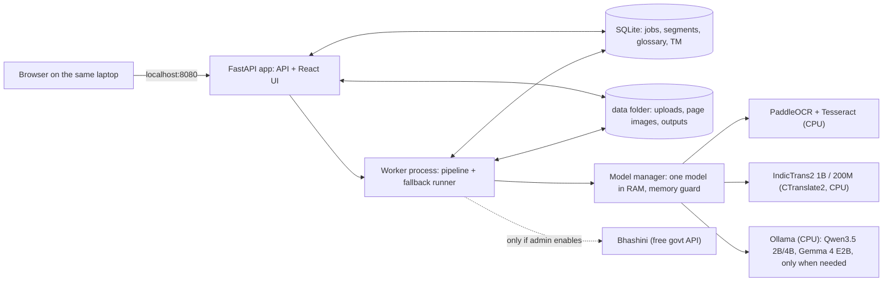
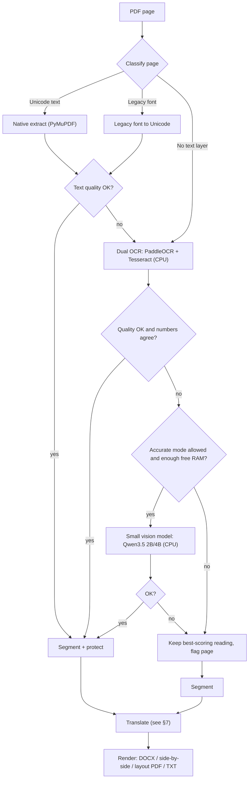
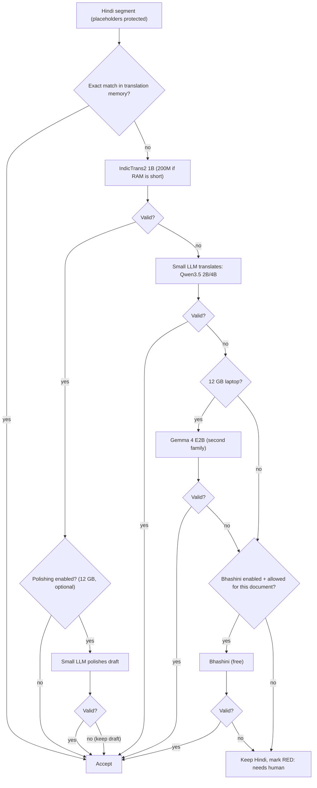

# Hindi PDF Translator: Project Plan

> **Request (Vikram Chandra):** We get many documents from Beltron, all in Hindi. We need a small web page where anyone on the team can upload a PDF and get it translated. Today this is done by hand with Copilot, which sometimes won't accept the upload.
>
> **Added requirements:**
> - It runs **locally**.
> - It uses **only free or local models** (no paid APIs).
> - It runs on an **ordinary office laptop with 8 GB of RAM (12 GB at most)**.
> - It has **fallbacks**.
> - Its translation quality is the **best achievable within these limits**.

| | |
|---|---|
| Status | Draft v3, for review |
| Date | 2026-10-11 |
| Scope | Hindi (including Hindi mixed with English) to English. The design leaves room for English to Hindi and other Indian languages later. |
| Changes in v3 | Redesigned for **laptops with 8–12 GB RAM and no graphics card**. Large models (27B–32B) are replaced by small engines that run on the processor. **Only one model is loaded at a time**, and a memory check switches to a smaller model when memory runs short. The app is installed directly on Windows instead of through Docker. Each person runs their own copy at `localhost`. The large-model setup from v2 remains an optional "workstation" profile. |
| Changes in v2 | Removed every paid cloud API. Bhashini, the free Government of India API, remains as an optional fallback that is off by default. |

---

## 1. Summary

- **What we build:** a small app that each person installs on their own laptop.
  - It opens in the browser at `http://localhost:8080`.
  - You drag in a PDF and it translates in the background while you keep working.
  - You review the English side by side with the original.
  - You download a Word file, a PDF that keeps the original layout, or plain text.
- **Runs on an 8 GB laptop with no graphics card:**
  - The app loads **one model at a time** and keeps its own memory use **under about 3 GB**, so Windows, Office and the browser keep working.
  - On a 12 GB laptop it uses the extra room for a second checking model and for better OCR on difficult scans.
- **Free and local only:** every model is open-weight with a free licence. There are no paid APIs and no per-page charges, and the software costs nothing. Documents never leave the laptop. The only optional external service is Bhashini (free, run by the Government of India), and it is off by default.
- **The laptop limit does not reduce the main translation quality:**
  - The main engine, **IndicTrans2 1B**, runs on the processor (CPU). It is the strongest open-source Hindi-to-English model in the published comparisons we found, and it has an MIT licence. It produces the same translations it would on a graphics card, only more slowly.
  - What the laptop limit removes is the large "polishing" LLM and the large OCR model for very bad scans (see §4.3).
- **The text-extraction step matters most.** Bihar government PDFs often use legacy fonts such as Kruti Dev, or are scans, and in both cases copy-paste gives gibberish. The pipeline sorts pages by type and extracts each type differently.
- **Fallbacks at every step:**
  - Every stage has 2–4 local engines.
  - If memory runs short, the app switches to a smaller model.
  - Jobs continue after the laptop sleeps or restarts.
  - In the worst case one sentence is marked "needs human review". A document is never just reported as failed.
- **"Best" is measured:** before choosing the defaults, we run a blind test of real Beltron documents **on an actual 8 GB laptop**, against today's Copilot output.
- **Timeline for one developer:** a working version in about 2 weeks. About 8 weeks until it is ready for daily use, including a Windows installer.

---

## 2. Requirements

### Functional

| ID | Requirement |
|---|---|
| F1 | Upload one or more PDFs by drag and drop. Default limits are 50 MB and 100 pages per file, both configurable. |
| F2 | Translate Hindi, including code-mixed Hindi and English, into English. |
| F3 | Outputs: **editable Word (.docx)**, **side-by-side web view**, **PDF with the original layout**, and plain text. |
| F4 | Show progress page by page, list jobs, keep a history, and show a Windows notification when a job is done. |
| F5 | Let users review and correct individual sentences. Approved corrections are reused automatically next time (translation memory). |
| F6 | A glossary **shared by the team** across laptops, for example ज्ञापांक → "Memo No." and कार्यादेश → "Work Order". |

### Non-functional

| ID | Requirement |
|---|---|
| N1 | **Free and local:** only free, openly licensed models running on the laptop. No paid APIs or subscriptions. Works with no internet after installation. |
| N2 | **Laptop hardware:** runs on a Windows 10/11 laptop with **8 GB RAM**, 4 CPU cores, **no graphics card**, and about 15 GB of free disk space. **Peak memory use: no more than 3 GB on 8 GB laptops, and no more than 6 GB on 12 GB laptops.** The laptop stays usable for Office and the browser while a job runs. |
| N3 | **Fallback:** no single failure stops a translation. That includes a crashed model, low memory, a bad scan, a strange font, or the laptop going to sleep. |
| N4 | **Quality:** at least as good as the current Copilot output in a blind review. **No errors in numbers, dates or reference numbers.** |
| N5 | **Privacy:** documents stay on the laptop. Files are deleted automatically after N days. The app listens only on `localhost`. |
| N6 | **Easy to run:** one installer and a desktop shortcut. No Docker, and no command line for users. |

### Assumptions (to be confirmed)

- The laptops run Windows 10 or 11, with a 4+ core Intel Core i5 or Ryzen 5 class processor (2019 or newer) and an SSD.
- Each person runs their own copy and translates a few documents a day, usually 1–30 pages each.
- Document types: letters, office orders, tenders, RFPs and corrigenda, work orders, empanelment notices and minutes. Many contain **tables, stamps, signatures and handwritten notes**.
- A mix of digitally created PDFs and scans.

### Open questions for Vikram and the team

1. What are the actual volume and typical page counts?
2. May we use **Bhashini** (the free Government of India language API) as an optional fallback for non-confidential documents? Or must everything stay strictly offline? The plan works either way. Bhashini is off by default.
3. **What exact laptop models will run this** (processor, RAM, Windows version, free disk space)? **We need one representative 8 GB laptop to test on in week 1.**
4. **Can IT install software on these laptops** (the app, Tesseract, Ollama)? Or does it have to be a portable install that needs no admin rights?
5. Which output do people use most: an editable Word file or a PDF that looks like the original?
6. Will we need **English to Hindi** later, for drafting replies to Beltron? IndicTrans2 covers that direction too.
7. Who can spend about 2 days as a bilingual reviewer to build the evaluation set (§13)?

---

## 3. Why Hindi PDFs are harder than they look

The translation model is not the main risk. **Most quality is lost before translation starts**, when the text is pulled out of the PDF.

| Page type | What naive copy-paste gives | How we handle it |
|---|---|---|
| **A. Digital, Unicode font** (Mangal, Nirmala UI) | Usually correct, but vowel signs and conjunct letters sometimes come out in the wrong order | Extract the text, check its quality, and run OCR on the page if the check fails |
| **B. Digital, legacy font** (Kruti Dev, DevLys, Chanakya; very common in Bihar government offices) | Latin-letter gibberish. For example, `fcgkj ljdkj` is how **बिहार सरकार** is stored in Kruti Dev | Detect the font name, convert the text to Unicode and check it. Run OCR if the conversion fails |
| **C. Scanned or photographed** | No text at all | OCR |
| **D. Mixed** (typed text plus stamps, signatures and handwritten notes) | Some text is missing | Process each region separately. Flag handwriting for human review |

Other complications:

- Tables, such as bills of quantities and eligibility criteria.
- Devanagari digits (२०२६) and Indian number grouping (5,00,000/-).
- English terms written in Latin script inside Hindi sentences (RFP, GeM, EMD, SLA).
- Reference numbers such as `ज्ञापांक-1234/2026`, which must survive translation exactly.

Types A and B cover most digital Beltron documents. **They need no AI model at all to extract**, which suits a laptop well.

---

## 4. Engines for 8–12 GB laptops

### 4.1 Memory budget

Windows 11 with Outlook, Office and a browser typically uses 4–5 GB. **On an 8 GB laptop that leaves the app about 3 GB.** On a 12 GB laptop it leaves about 6 GB.

So the design follows one rule: **only one model is in memory at a time.** Each stage loads its model, processes the whole document, then unloads it before the next stage starts (§6).

### 4.2 Engine choices

All engines run on the processor and are free and openly licensed. The RAM column shows roughly how much memory each needs while it runs. We measure the real figures in Phase 0.

| Stage | 8 GB laptop | 12 GB laptop | RAM while running | Why |
|---|---|---|---|---|
| PDF parsing | **PyMuPDF** | same | < 0.3 GB | Fast. Gives text, font names, layout boxes and tables. No model needed. |
| Legacy font conversion | **legacylipi** (Kruti Dev) plus our own mapping tables | same | negligible | Kruti Dev and similar fonts are everywhere in Bihar government documents. |
| OCR, standard (both engines run, better result kept) | **PaddleOCR PP-OCRv5 Devanagari mobile** + **Tesseract 5** `hin+eng` | same | ~0.5–1 GB | Both are small and fast on CPU. Two different engines let us cross-check numbers and keep the better reading of each page. PaddleOCR must use its **Devanagari model**, because its default multilingual model garbles Hindi. |
| OCR, accurate mode (flagged pages only) | **Qwen3.5-2B**, reading the page image | **Qwen3.5-4B**, or PaddleOCR-VL 0.9B | ~2 / ~3.5 GB | Small vision-language models read difficult pages better than classic OCR. On CPU they take about 1–3 minutes per page, so they never run on every page. |
| Machine translation | **IndicTrans2 1B, Indic→English, int8** (CTranslate2) | same | ~1.5 GB | The same model and quality as on a graphics card, just slower. Shrinking it to int8 usually costs very little accuracy, and we confirm that on our test set. |
| Translation when memory is short | **IndicTrans2 distilled 200M, int8** | same | ~0.4 GB | Used when free memory is low, and in "Fast draft" mode. |
| Quality check | **IndicTrans2 English→Indic distilled 200M** (back-translation, see §7.3) | same | ~0.4 GB | Cheap. Runs on every sentence. |
| LLM fallback (only sentences that fail the checks) | **Qwen3.5-2B** (4-bit) | **Qwen3.5-4B** (4-bit), then **Gemma 4 E2B** (QAT) as a second model family | ~2 / ~3.5 / ~4 GB | Loaded through Ollama only when needed, then unloaded. |
| LLM polishing of every sentence | **Off** | Optional. Turned on only if the blind test shows it helps. | n/a | Small 2–4B models are weaker at Hindi than IndicTrans2, so we don't let them rewrite good translations by default. |
| Optional free external service (**off by default**) | **Bhashini** | same | none locally | Useful only for documents allowed to leave the laptop. It needs both an admin switch and the user's permission for that document. |

**Excluded:**
- **Models above about 4B parameters**, such as the 27B–32B models from v2. They need 16–24 GB of memory. They remain only in the optional `workstation` profile (§11).
- **Gemma 4 E4B.** Despite the "4B" in its name, it uses about 7–8 GB in practice.
- **Paid APIs** (Claude, GPT, Gemini, Google, Azure, DeepL).
- **The free tiers of commercial APIs.** Their terms may let the provider use what we send, and their quotas can change without notice.

### 4.3 What these limits cost, and what they don't

| | Effect |
|---|---|
| ✅ **Unchanged** | The main translation engine. IndicTrans2 1B gives the same quality on a laptop. Text extraction for digital PDFs (types A and B) needs no model at all. |
| ⚠️ **No large LLM polishing every sentence** | The English is somewhat more literal. The glossary, the translation memory and a consistency pass (§8) keep terminology consistent instead. |
| ⚠️ **Hard scans and handwriting** | Classic OCR and small vision models are weaker than the 8B–32B vision models on bad scans. Expect more amber and red sentences for human review on those pages. |
| ⚠️ **Speed** | A laptop processor is slower than a graphics card. A scanned 10-page document takes several minutes (§11). It runs in the background, and a notification appears when it finishes. |
| ⚠️ **Compared with Copilot** | Copilot uses large cloud models. Our realistic edge is **correct extraction** (Kruti Dev fonts and scans), **exact numbers**, **consistent terminology**, privacy and no upload limits. Fluency may be slightly behind on some sentences. The blind test measures this. |

---

## 5. Architecture



- **Native Windows install, no Docker.** Docker Desktop on Windows sets aside 2 GB or more of RAM, which an 8 GB laptop can't spare.
- **Model manager and memory guard:**
  - Before loading any model, the manager checks free memory with `psutil`.
  - If there isn't enough for the model plus a 0.5 GB safety margin, it uses the smaller variant or skips the optional step and flags the sentence.
  - It never pushes the laptop into heavy swapping.
- **One user, one laptop:**
  - The app listens only on `127.0.0.1`, so other people on the network can't reach it, and no login is needed.
  - An optional **shared mode** lets one machine serve a few colleagues over the LAN, with login turned on. This is not recommended on 8 GB laptops.
- **Durable job queue in SQLite:** each sentence is saved as soon as it is done. A job continues where it stopped after sleep, shutdown or a crash.
- **Hardware profiles:** at start-up the app reads the installed RAM and picks the `laptop-8gb`, `laptop-12gb` or `workstation` profile (§10). A user can override this choice.
- **Ollama is optional.** Without it the app still works with IndicTrans2 and classic OCR, but without the LLM fallback and accurate mode.

---

## 6. Processing pipeline

**Processing runs one stage at a time, not page by page.** Each stage loads its model once, processes the whole document, and unloads it. That keeps one model in memory at a time.



1. **Intake.**
   - Check the file type and size, and save it under a random ID.
   - Encrypted PDFs prompt the user for the password.
   - Each page is rendered to a 300 DPI image **on disk, one page at a time**, so pages never pile up in memory.
2. **Classify each page.**
   - Font names such as `KrutiDev010` or `DevLys` mean a legacy font.
   - Little or no extractable text means a scan.
   - The **Hindi dictionary hit rate** (the share of words that are real Hindi words) measures text quality.
3. **Extract**, as one stage for the whole document.
   - **Type A:** PyMuPDF text in reading order, with tables from `find_tables()`.
   - **Type B:** convert the legacy font, then check the dictionary hit rate again.
   - **Type C/D, standard mode:** clean up the image first (deskew, denoise and adaptive binarisation, using OpenCV). Then run **PaddleOCR and Tesseract** on it, and keep the better reading by dictionary hit rate.
   - **Number cross-check:** numbers, dates and reference numbers must agree between the two OCR engines, or the sentence is flagged amber.
   - **Accurate mode:** flagged pages are re-read by the small vision model. This happens automatically for up to 3 pages per document in Standard mode, for all flagged pages in Accurate mode, and on request with the "Re-read this page carefully" button.
4. **Normalise.**
   - Unicode NFC, consistent nukta forms and Devanagari digits converted to ASCII digits.
   - Common OCR confusions (`ं`/`ँ`, `ठ`/`ढ`) checked against the dictionary.
5. **Segment and protect.**
   - Split into sentences on `।`, `?`, `!` and line structure, using the Indic NLP Library.
   - Numbers, dates, amounts, reference numbers, emails, URLs, Latin-script words and glossary terms are replaced by placeholders such as `⟦N1⟧` and `⟦G3⟧`. They are restored after translation, so no model can corrupt them.
6. **Translate** (stage: IndicTrans2 1B is loaded once and translates all sentences in small batches).
7. **Check** (stage: the 200M English→Hindi model back-translates every sentence). Run the validators and assign confidence colours.
8. **Fall back** (stage: only for sentences that failed the checks). Ollama loads the small LLM, works through those sentences, then unloads it.
9. **Render.**
   - **DOCX** (python-docx): headings, paragraphs and real Word tables, with one page break per source page. Stamps and signatures appear as `[Stamp]` and `[Signature]`.
   - **Side-by-side view:** the original page image next to the English. Clicking a sentence highlights it in both.
   - **Layout PDF:** each Hindi text block is covered and the English is written into the same box, with the font shrunk to fit.
   - **TXT and Markdown:** always produced.

---

## 7. Fallback design

### 7.1 Fallbacks at every layer

| Layer | 1st choice | 2nd | 3rd | Last resort | Moves to next when |
|---|---|---|---|---|---|
| Text extraction | Native (PyMuPDF) | Legacy-font conversion | Dual OCR | n/a | Low dictionary hit rate, or a known legacy font |
| OCR | Dual classic OCR (PaddleOCR + Tesseract, better kept) | Small vision model (accurate mode) | n/a | Keep the best-scoring reading and flag the page | Low dictionary hit rate, or numbers disagree |
| Translation | IndicTrans2 1B | Small LLM: Qwen3.5-2B or 4B | Gemma 4 E2B, second family (12 GB only) | Bhashini (if enabled **and** allowed), then keep the Hindi and **flag it red** | A validator fails, timeout, or engine error |
| **Memory** | The planned model | Its smaller variant (IndicTrans2 200M, Qwen3.5-2B) | Skip the optional step (accurate mode or LLM) and flag amber | Pause the job and ask the user to close other apps | Free RAM is below what the model needs plus 0.5 GB |
| Output | Layout PDF | DOCX | HTML side-by-side | TXT | A render error or text overflow. TXT is always produced. |
| Power and sleep | n/a | n/a | n/a | Resume from the last saved sentence | The laptop sleeps, restarts or crashes |

### 7.2 Per-sentence flow



### 7.3 Validators (these decide when to fall back)

These are cheap, deterministic checks, run on every sentence:

1. **Placeholders:** every `⟦…⟧` from the source appears in the output exactly once.
2. **Numbers:** the set of numbers in the source equals the set in the output, after converting Devanagari digits. Lakh and crore are kept as written, never converted.
3. **Script:** the output is English, with less than 5% Devanagari characters other than allowed names.
4. **Length ratio:** the ratio of English to Hindi characters stays within bounds. We tune the bounds on our own data, starting at roughly 0.6–2.0.
5. **No loops or chatter:** no repeated n-grams, and no preamble such as "Here is the translation".
6. **Glossary:** every glossary term found in the source uses the approved English term.
7. **Back-translation score:** the small IndicTrans2 English→Hindi model translates the English back to Hindi, and we compare it with the source using chrF. A low score turns the sentence amber. This quality check is free, small and licence-safe (see §12).

**Confidence colours in the UI:**
- 🟢 Green: all checks pass and the back-translation score is high.
- 🟡 Amber: a fallback engine was used, the back-translation score is low, or the OCR engines disagreed.
- 🔴 Red: untranslated, or a number or placeholder doesn't match.

Reviewers only need to read the amber and red sentences.

### 7.4 Engine health and the memory guard

- Every engine call has a timeout and is retried up to 2 times.
- **Circuit breaker:** after 3 failures in a row, an engine is skipped for the rest of the job. A broken Ollama install therefore can't slow every sentence down.
- **Memory guard:** free RAM is checked before every model load (see the Memory row in §7.1).
- CPU threads are capped at the number of cores minus one, so the laptop stays responsive while a job runs.

### 7.5 Resilience at job level

- Progress is saved after every page and every sentence. Jobs survive sleep, shutdown and crashes.
- A job is "done" even when some sentences are red. The UI shows "3 segments need review", never a bare "failed".
- The job log records which engine produced each sentence.
- The Settings page shows the **fallback rate**. A spike means something is wrong, such as Ollama not running or too little memory.

---

## 8. Quality strategy (the best we can do on a laptop)

1. **Fix extraction first** (§3, §6). Clean Unicode input is the biggest single gain, and on digital PDFs it costs no model at all.
2. **IndicTrans2 1B does the translating.** It is the strongest open Hindi-to-English model in published comparisons, and it fits in about 1.5 GB. Small LLMs are only a **fallback** for sentences that fail the checks.
3. **Local ensemble for amber sentences** (12 GB laptops):
   - We generate candidates from IndicTrans2 1B, IndicTrans2 200M and Qwen3.5-4B, one model at a time.
   - Candidates must pass the validators, and we keep the one with the best back-translation score.
   - This only runs for amber sentences, which we expect to be a small share.
4. **Glossary**, enforced through placeholders, so it doesn't depend on a large LLM. It is seeded with Beltron and Bihar government terms (Appendix A) and checked by validator 6.
5. **Consistency pass across the document:** the same Hindi name, designation or term always gets the same English throughout. Rules choose the most common or glossary rendering. This replaces the document-level consistency a large LLM would have given.
6. **Translation memory:** every approved sentence pair is stored.
   - Exact matches are reused directly.
   - Close matches are shown to the reviewer and given to the LLM fallback as examples.
   - Beltron letters follow standard formats, so the memory improves quickly.
7. **Team sync for glossary and memory:** each laptop has its own copy, so they need syncing (§9). Corrections made by one person help everyone.
8. **Human in the loop:** reviewers fix amber and red sentences, and their fixes go into the translation memory.
9. **Measure, don't guess:** blind tests and regression checks run on a real 8 GB laptop (§13).

**Prompt for the small-LLM fallback (sketch):**
```
System: Translate Indian government correspondence (Bihar, BELTRON) from Hindi to English.
Preserve meaning exactly. Use the GLOSSARY terms verbatim. Keep every ⟦…⟧ placeholder
unchanged. Formal Indian-English official style. Output only JSON: {"translation": "..."}
User: GLOSSARY: <matched terms> | EXAMPLES: <2 similar approved pairs from TM>
      HINDI: <source>
```

---

## 9. Web UI

| Page | Features |
|---|---|
| **Upload** | Drag and drop one or more PDFs, and choose outputs and a glossary. **Mode:** *Fast draft* (IndicTrans2 200M and classic OCR, about 3× faster, for a quick read), *Standard*, or *Accurate* (the small vision model re-reads all flagged pages, which is slow). If an admin has enabled Bhashini, a checkbox **"Allow Bhashini fallback for this document"** appears, off by default. |
| **Jobs** | A list with status, a progress bar for each page, counts of segments needing review, and download and delete buttons. A Windows notification appears when a job finishes, so you can keep working. |
| **Review** | The original page on the left and the English on the right, colour-coded by confidence. Click a sentence to edit or approve it, or to **re-translate it with another engine**. A **"Re-read this page carefully"** button runs accurate-mode OCR on one page. Includes "Copy all English". |
| **Glossary and memory** | Add, edit, and import or export the glossary as CSV. **Team sync:** point the app to a shared network folder, or export and import a sync file, so every laptop has the team's latest glossary and translation memory. |
| **Settings** | The active profile (8 GB, 12 GB or workstation), current memory use, engine status (Ollama found or not), fallback rate, retention period and Bhashini on/off. |

The interface is in English with Hindi labels where helpful. It is designed to work for non-technical staff with zero training.

---

## 10. Tech stack and code layout

| Concern | Choice |
|---|---|
| Backend | Python 3.12, FastAPI, Pydantic, SQLAlchemy and SQLite (WAL mode) |
| Worker | A separate Python process from the same codebase. It uses a durable queue stored in the database and a capped number of CPU threads. |
| Model manager | Loads and unloads models and checks free memory with `psutil` |
| PDF | PyMuPDF (pypdfium2 as fallback), OpenCV for image clean-up |
| OCR | PaddleOCR `devanagari_PP-OCRv5_mobile_rec`, run through PaddleOCR or RapidOCR (ONNX Runtime), whichever is lighter on Windows. Tesseract 5 via `pytesseract`, with `tessdata_best` `hin` and `eng`. |
| Accurate-mode OCR and LLM fallback | Ollama on CPU, with Qwen3.5-2B or 4B and Gemma 4 E2B (QAT), unloaded right after use (`keep_alive: 0`) |
| Translation | IndicTrans2 via CTranslate2 int8 plus IndicTransToolkit. **If CTranslate2 conversion doesn't work, the fallback is ONNX Runtime int8.** Sentences are split with the Indic NLP Library. |
| Outputs | python-docx and PyMuPDF |
| Frontend | React, Vite, TypeScript and pdf.js, built to static files and served by FastAPI |
| Packaging | **Windows installer** (PyInstaller and Inno Setup), or a portable zip that needs no admin rights. Models are included. An **offline bundle** can be copied from USB or a network share. |
| Tests | pytest with PDF test files for every page type (A–D), a **memory test** that fails if peak RAM goes over the budget, and the evaluation scripts in `eval/` |

```
pdf-translator/
├── backend/
│   ├── app/
│   │   ├── main.py                 # FastAPI routes (upload, jobs, review, glossary, settings)
│   │   ├── config.py               # profiles + settings
│   │   ├── db.py, models.py        # SQLite schema: jobs, pages, segments, glossary, tm, log
│   │   ├── worker.py               # stage-by-stage, resumable job runner
│   │   ├── model_manager.py        # one-model-at-a-time loading + memory guard
│   │   ├── sync.py                 # glossary/TM team sync (shared folder or file)
│   │   └── pipeline/
│   │       ├── classify.py         # page type A/B/C/D
│   │       ├── extract.py          # native text + legacy-font conversion
│   │       ├── ocr/                # paddle.py, tesseract.py, vlm_small.py, dual.py
│   │       ├── segment.py          # sentence split + placeholder protection
│   │       ├── translate/          # indictrans2.py, llm_fallback.py, ensemble.py, bhashini.py
│   │       ├── validate.py         # validators + back-translation + confidence
│   │       ├── consistency.py      # same term → same English across the document
│   │       ├── chain.py            # fallback runner + circuit breaker
│   │       └── render/             # docx.py, layout_pdf.py, html.py, txt.py
│   └── tests/
├── frontend/                       # React + Vite
├── profiles/                       # laptop-8gb.yaml, laptop-12gb.yaml, workstation.yaml
├── eval/                           # golden set, metrics, bake-off scripts (run on the test laptop)
├── packaging/                      # Windows installer, portable build, offline bundle script
├── models/                         # downloaded weights (git-ignored)
└── docs/                           # user guide, IT install guide
```

**Engine interface.** Every engine implements this interface, which makes fallbacks and swaps simple:
```python
class Translator(Protocol):
    name: str
    ram_gb: float            # what the memory guard checks before loading
    is_external: bool        # True only for Bhashini
    def load(self) -> None: ...
    def unload(self) -> None: ...
    def translate(self, segs: list[Segment], ctx: DocContext) -> list[Candidate]: ...
```

**Profiles.** The app picks one automatically from the installed RAM:
```yaml
# profiles/laptop-8gb.yaml
ram_budget_gb: 3
cpu_threads: auto            # cores - 1
ocr: [dual_classic, vlm_small]
vlm_small_model: qwen3.5:2b
mt_model: indictrans2-indic-en-1B-int8
mt_low_memory_model: indictrans2-indic-en-dist-200M-int8
qe_model: indictrans2-en-indic-dist-200M-int8
llm_fallback: [qwen3.5:2b]
polish_every_sentence: false
accurate_mode_auto_pages: 3
bhashini: { enabled: false }
limits: { max_mb: 50, max_pages: 100, retention_days: 30 }

# profiles/laptop-12gb.yaml  (differences only)
ram_budget_gb: 6
vlm_small_model: qwen3.5:4b
llm_fallback: [qwen3.5:4b, gemma4:e2b-it-qat]
ensemble_for_amber: true
polish_every_sentence: false   # switch on only if the bake-off shows a gain

# profiles/workstation.yaml  (optional: 16 GB+ RAM or an NVIDIA GPU; the v2 large-model setup)
llm_fallback: [qwen3.6:27b, gemma4:31b]
vlm_small_model: qwen3-vl:8b
polish_every_sentence: true
```
The exact Ollama tags are confirmed in Phase 0.

---

## 11. Hardware, speed and installation

| Profile | Hardware | App memory budget | What runs | Rough time for a 10-page document* |
|---|---|---|---|---|
| **laptop-8gb** (minimum) | 8 GB RAM, 4 cores, SSD, no graphics card | ~3 GB | IndicTrans2 1B, dual OCR, Qwen3.5-2B fallback, accurate mode on up to 3 pages | Digital: ~2–4 min. Scanned: ~5–10 min. Fast draft: about a third of that. |
| **laptop-12gb** | 12 GB RAM, 4+ cores, SSD | ~6 GB | Everything above, plus Qwen3.5-4B, Gemma 4 E2B and the amber ensemble | About the same. Better on hard pages. |
| **workstation** (optional, later) | 16 GB+ RAM or an NVIDIA GPU | Large | The large-model setup from v2 | Faster and better on bad scans. Not required. |

Each accurate-mode page adds about 1–3 minutes on CPU.

\*These are planning estimates. **Phase 0 measures real time and peak memory on the team's actual laptop**, and we update this table.

**Disk space:**

| What | Size |
|---|---|
| App, runtimes, IndicTrans2 1B and 200M (both directions), PaddleOCR and Tesseract | **~3 GB** |
| Plus Qwen3.5-2B, for the 8 GB profile | ~1.5 GB |
| Plus Qwen3.5-4B and Gemma 4 E2B, for the 12 GB profile | ~7 GB |
| **Total** | **About 5 GB (8 GB profile) or 10 GB (12 GB profile)** |

**Installation:**

1. Run the installer, or unzip the portable build. It needs no internet if you use the offline bundle.
2. Optionally install Ollama. Without it, the app works but has no LLM fallback and no accurate mode.
3. Double-click the desktop shortcut. The browser opens at `http://localhost:8080`.

The IT install guide covers silent install for pushing the app to many laptops, antivirus exclusions for the models folder, and how to update models later.

**Tips for users (also shown in the app):**
- Close heavy apps before translating large scanned documents.
- Keep the laptop plugged in for long jobs.
- If the laptop sleeps, the job simply continues when it wakes.

**Cost:**

| Item | Cost |
|---|---|
| Models and software | **0**. Every component is open-source or has an open-weight licence. |
| Per-page or API charges | **0**. No paid APIs are used. |
| Hardware | **0**. Uses existing laptops. |

---

## 12. Security, privacy and licensing

- **Documents never leave the laptop.** The app listens only on `127.0.0.1`. The only external path is the optional Bhashini adapter, which needs both an admin switch and the user's permission for that document. Each Bhashini call is logged.
- **Laptops get lost.** Turn on **BitLocker** (Windows disk encryption). Uploads, page images and outputs are deleted automatically after N days (default 30), and users can delete a job immediately.
- **Untrusted files:** PDFs are parsed in the worker process with limits on memory, time and page count. We never run PDF JavaScript.
- **Team sync** shares only the glossary and translation memory, never documents. Translation memory can contain sentences from documents, so the shared folder needs the same access control as the documents themselves.

**Licences.** Every component is free to use. Verify each licence on its model card before production.

| Component | Licence | Note |
|---|---|---|
| IndicTrans2 (1B, 200M) | MIT | ✅ Free |
| Qwen3.5 small models (2B, 4B) | Apache-2.0 (verify on the model card) | ✅ Free |
| Gemma 4 E2B | Apache-2.0 | ✅ Free |
| PaddleOCR, PaddleOCR-VL, RapidOCR | Apache-2.0 | ✅ Free |
| Tesseract | Apache-2.0 | ✅ Free |
| CTranslate2, ONNX Runtime, Ollama | MIT | ✅ Free |
| PyMuPDF | AGPL-3.0 (or commercial) | Fine for an internal tool, but confirm with whoever handles legal. pypdfium2 (permissive) is the drop-in alternative. |
| Bhashini (optional) | Free Government of India service | Check its terms of use and access process before enabling |
| NLLB-200, CometKiwi | Non-commercial | ❌ **Not used.** This is why our quality check uses back-translation instead. |
| legacylipi | Check | Confirm before adopting, or replace with our own mapping tables |

---

## 13. Evaluation and acceptance criteria

**Golden set (built in Phase 0, by one bilingual reviewer in about 2 days):**
- 30–50 real documents covering page types A–D, tables and stamps.
- 20 scanned pages with hand-checked Hindi text, to measure OCR quality as character error rate.
- 150–200 sentences with reference English translations.
- Copilot outputs for 15 documents, as today's **baseline**.

**Every test runs on a representative 8 GB laptop**, measuring quality, **time** and **peak RAM**.

**Candidates (all fit in 8–12 GB, all free):**
- **Translation:**
  - IndicTrans2 1B int8
  - IndicTrans2 200M int8
  - IndicTrans2 1B + Qwen3.5-4B polishing (12 GB)
  - IndicTrans2 1B + Gemma 4 E2B polishing (12 GB)
  - Qwen3.5-4B direct
  - TranslateGemma 4B direct
  - The amber ensemble
- **OCR:**
  - Tesseract
  - PaddleOCR Devanagari
  - Dual OCR, keeping the better reading
  - Qwen3.5-2B and 4B vision
  - PaddleOCR-VL 0.9B
- **Baseline only:** Copilot. It is not part of the system.

**Metrics:**
- **Automatic:** chrF++ and COMET (`wmt22-comet-da`) against the references, plus OCR character error rate.
- **Human, blind:** the reviewer sees two anonymous translations side by side and picks the better one. The reviewer also counts **critical errors** (wrong number, date, name, negation or obligation).

**Acceptance criteria for go-live:**

| Criterion | Target |
|---|---|
| Blind comparison with Copilot | **At least as good overall** (wins plus ties ≥ 50%), and **better on numbers and terminology** |
| Critical errors (numbers, dates, reference numbers, names) | **0** in the golden set |
| Glossary terms used correctly | **≥ 95%** |
| Documents that finish (any confidence) | **100%** |
| Peak RAM used by the app | **≤ 3 GB** (8 GB profile), **≤ 6 GB** (12 GB profile) |
| 10-page document on the 8 GB test laptop | Digital **≤ 5 min**. Scanned **≤ 10 min**, excluding accurate-mode pages. |
| Laptop stays usable during a job | Office, Outlook and the browser stay responsive. Checked by hand. |

The bake-off is **rerun every quarter**. Small models are improving fast, and the plug-in design makes switching a config change.

---

## 14. Roadmap (one developer)

| Phase | Weeks | Deliverables | Done when |
|---|---|---|---|
| **0. Discovery and setup** | 1 | Get **one representative 8 GB laptop**. Collect 50 sample PDFs and sort them by type A–D. Record the Copilot baseline. Seed the glossary with 100–200 terms. **Spikes on the laptop:** IndicTrans2 int8 conversion, speed and RAM; the PaddleOCR Devanagari model and Tesseract on 5 scans; Qwen3.5-2B and 4B RAM and speed in Ollama. Confirm the IT install policy. | Real speed and memory numbers recorded. Samples and baseline ready. |
| **1. MVP** | 2–3 | FastAPI app, upload, job queue and stage-by-stage worker, model manager. Type A extraction and Tesseract OCR. Segmentation and placeholders. IndicTrans2 1B int8. DOCX and side-by-side output. Minimal React UI. A start script for the test laptop. | **The team translates real Beltron documents on an 8 GB laptop** |
| **2. Quality and fallbacks** | 3–5 | Page classifier and legacy-font conversion. Dual OCR with number cross-check, image clean-up and tables. Memory guard and profiles. Validators, back-translation and confidence colours. Small-LLM fallback, accurate mode and the amber ensemble (12 GB). Consistency pass. **Bake-off on the laptop.** | Bake-off report written, defaults chosen and acceptance criteria met |
| **3. Review and reuse** | 5–6 | Sentence editor, "Re-translate with…", "Re-read this page carefully", translation memory, glossary admin and **team sync** | Corrections reach every laptop |
| **4. Packaging and hardening** | 6–8 | **Windows installer, portable build and offline bundle.** Retention and auto-delete. Layout-preserving PDF. Notifications. Settings page. Optional Bhashini adapter, if approved. User guide and IT install guide. **Pilot on 3–5 team laptops.** | **Go-live** |
| **5. Later (optional)** | n/a | English → Hindi for replies, other Indian languages, a shared workstation profile if a bigger machine becomes available | Prioritised by usage |

---

## 15. Risks and mitigations

| Risk | Impact | Mitigation |
|---|---|---|
| Not enough free RAM because of other apps (Chrome tabs, Teams) | The job slows down or the laptop lags | Only one model at a time, the memory guard, smaller-model fallbacks, and pausing the job with "close other apps" instead of swapping |
| Older or slower laptop processors | Long waits | Fast draft mode, background processing and notifications. Phase 0 measures the real speed and sets a minimum processor spec. |
| Small LLMs are weak at Hindi | Poor fallback translations | IndicTrans2 does the main work. LLMs are only a checked fallback, and anything that fails is flagged. |
| Hard scans and handwriting | Missing or wrong text | Dual OCR with number cross-check, accurate mode on flagged pages, and human review |
| IndicTrans2 doesn't convert to CTranslate2 | No fast CPU engine | ONNX Runtime int8, or PyTorch dynamic int8 quantisation. Tested in Phase 0. |
| IT blocks software installation | No rollout | A portable build that needs no admin rights. Involve IT in week 1 (question 4). |
| Glossaries and memories drift apart across laptops | Inconsistent terminology | Team sync through a shared folder or a sync file |
| A lost or stolen laptop holding documents | Data exposure | BitLocker, automatic deletion and no cloud copies |
| Copilot reads more fluently on some sentences | Users prefer Copilot for some documents | A realistic target (at least as good overall). Our advantages: extraction, numbers, terminology, privacy, no upload limits. |
| Legacy-font variants we don't recognise | Gibberish text | The dictionary hit rate catches it and the page is sent to OCR. We add mapping tables as new fonts appear. |
| Licence problems | Legal exposure | The licence table in §12. No non-commercial models. |

---

## 16. Next steps (this week)

1. Share this plan with Vikram and get answers to the **open questions** in §2, especially the **laptop models** and the **IT install policy**.
2. **Get one representative 8 GB laptop** for testing.
3. Collect about 50 sample Beltron PDFs and keep the Copilot output for 15 of them.
4. Find a bilingual reviewer for about 2 days in Phase 0 and Phase 2.
5. Start the Phase 0 tests on the laptop.

---

## Appendix A: Seed glossary (Beltron and Bihar government)

| Hindi | English |
|---|---|
| बिहार स्टेट इलेक्ट्रॉनिक्स डेवलपमेंट कॉरपोरेशन लिमिटेड / बेल्ट्रॉन | Bihar State Electronics Development Corporation Ltd. (BELTRON) |
| सूचना प्रावैधिकी विभाग | Department of Information Technology |
| प्रबंध निदेशक | Managing Director |
| अपर मुख्य सचिव / प्रधान सचिव / सचिव | Additional Chief Secretary / Principal Secretary / Secretary |
| ज्ञापांक | Memo No. |
| पत्रांक | Letter No. |
| दिनांक | Date / dated |
| सेवा में | To |
| विषय | Subject |
| प्रसंग / संदर्भ | Reference |
| महाशय / महोदय | Sir / Sir/Madam |
| उपर्युक्त विषय के संबंध में | With reference to the above-mentioned subject |
| अधोहस्ताक्षरी | the undersigned |
| आदेश से | By order |
| विश्वासभाजन | Yours faithfully |
| संलग्नक / अनुलग्नक | Enclosure / Annexure |
| प्रतिलिपि | Copy forwarded to |
| सूचनार्थ एवं आवश्यक कार्रवाई हेतु प्रेषित | Forwarded for information and necessary action |
| कार्यालय आदेश | Office Order |
| अधिसूचना | Notification |
| संकल्प | Resolution |
| निविदा | Tender |
| निविदा आमंत्रण सूचना | Notice Inviting Tender (NIT) |
| शुद्धि पत्र | Corrigendum |
| कार्यादेश | Work Order |
| सूचीबद्धता / पैनलबद्धता | Empanelment |
| अग्रधन राशि | Earnest Money Deposit (EMD) |
| वित्तीय वर्ष | Financial Year (FY) |
| लाख / करोड़ | lakh / crore (keep Indian units) |
| एतद् द्वारा | hereby |

## Appendix B: References used for engine choices

- IndicTrans2 paper: <https://arxiv.org/pdf/2305.16307>
- Hindi chrF++ comparison of IndicTrans2, Sarvam-Translate and TranslateGemma (on a competitor's model card, so treat with care): <https://huggingface.co/bodhan-ai/indic-translate>
- Sarvam-Translate compared with IndicTrans2: <https://github.com/Alok-Ranjan23/sarvam_translate/blob/master/README.md>
- "Can OCR-VLMs Read Devanagari?" (June 2026 benchmark): <https://arxiv.org/abs/2606.29213v1>
- Why extracting Hindi text from PDFs is hard: <https://digitalorientalist.com/2025/12/02/why-extracting-hindi-text-from-pdfs-is-so-much-harder-than-english-and-how-you-can-do-it/>
- legacylipi (legacy font to Unicode): <https://pypi.org/project/legacylipi/>
- PP-OCRv5 multilingual and Devanagari recognition: <https://www.paddleocr.ai/latest/en/version3.x/algorithm/PP-OCRv5/PP-OCRv5_multi_languages.html>
- PaddleOCR Hindi needs the Devanagari model (iText knowledge base): <https://kb.itextpdf.com/itext/pdfocr-paddleocr-model-support>
- PaddleOCR-VL: <https://www.paddleocr.ai/latest/en/version3.x/algorithm/PaddleOCR-VL/PaddleOCR-VL.html>
- Qwen3.5 small models (0.8B, 2B, 4B, 9B): <https://gigazine.net/gsc_news/en/20260303-qwen-3-5-small>
- Gemma 4 memory needs when run locally (Unsloth): <https://unsloth.ai/docs/models/gemma-4>
- Gemma 4 with Ollama, tag sizes: <https://codersera.com/blog/how-to-run-gemma-4-with-ollama-setup-guide/amp/>
- CTranslate2 (int8 CPU inference): <https://github.com/OpenNMT/CTranslate2/>
- Bhashini (Government of India language platform): <https://bhashini.gov.in>
