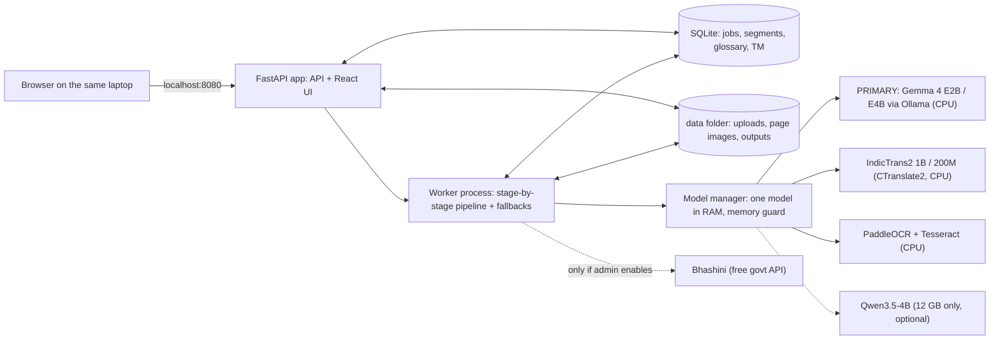
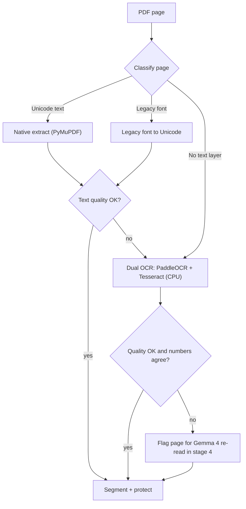
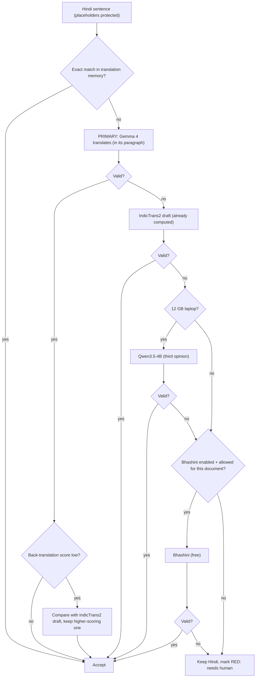

# Hindi PDF Translator: Project Plan

> **Request (Vikram Chandra):** We get many documents from Beltron, all in Hindi. We need a small web page where anyone on the team can upload a PDF and get it translated. Today this is done by hand with Copilot, which sometimes won't accept the upload.
>
> **Added requirements:**
> - It runs **locally**.
> - It uses **only free or local models** (no paid APIs).
> - It runs on an **ordinary office laptop with 8 GB of RAM (12 GB at most)**.
> - **Gemma 4 is the primary model.**
> - It has **fallbacks**.
> - Its translation quality is the **best achievable within these limits**.

| | |
|---|---|
| Status | Draft v4, for review |
| Date | 2026-10-11 |
| Scope | Hindi (including Hindi mixed with English) to English. The design leaves room for English to Hindi and other Indian languages later. |
| Changes in v4 | **Gemma 4 is now the primary translation model**: Gemma 4 E2B on 8 GB laptops and Gemma 4 E4B on 12 GB laptops. The same model also re-reads difficult scanned pages. **IndicTrans2 moves to a supporting role.** It produces a quick draft within minutes, and it is the first fallback whenever Gemma's version fails a check or memory is short. **Two consequences:** the app's memory limit on 8 GB laptops rises from about 3 GB to **about 4.5 GB**, and the final translation takes **longer** on a laptop processor (§11). Qwen3.5 is now only an optional third opinion on 12 GB laptops. |
| Changes in v3 | Redesigned for laptops with 8–12 GB RAM and no graphics card. One model in memory at a time, a memory guard, and a native Windows install instead of Docker. |
| Changes in v2 | Removed every paid cloud API. Bhashini (free, Government of India) remains as an optional fallback that is off by default. |

---

## 1. Summary

- **What we build:** a small app that each person installs on their own laptop.
  - It opens in the browser at `http://localhost:8080`.
  - You drag in a PDF and it translates in the background while you keep working.
  - You review the English side by side with the original.
  - You download a Word file, a PDF that keeps the original layout, or plain text.
- **Primary model is Gemma 4,** run locally on the laptop's processor through Ollama.
  - It translates **whole paragraphs** with context.
  - It follows the team glossary and handles mixed Hindi and English text and tables.
  - It writes natural English.
  - The same model also **re-reads scanned pages that classic OCR couldn't read**.
- **IndicTrans2 is the safety net.** It is the specialist translation model with the strongest published Hindi-to-English scores.
  - It produces a **quick draft within a few minutes**, so users can read something straight away while Gemma 4 finishes the final version.
  - It takes over for any sentence where Gemma's output fails a check.
  - It takes over the whole job if there isn't enough free memory for Gemma 4.
- **Runs on an 8 GB laptop with no graphics card.** Only one model is in memory at a time, and the app peaks at about 4.5 GB on 8 GB laptops and about 7 GB on 12 GB laptops. On 8 GB laptops, close heavy apps such as Teams or many Chrome tabs while the final translation runs.
- **Free and local only:** Gemma 4 and every other component are free and openly licensed. There are no paid APIs and no per-page charges. Documents never leave the laptop. The only optional external service is Bhashini (free, Government of India), and it is off by default.
- **The text-extraction step matters most.** Bihar government PDFs often use legacy fonts such as Kruti Dev, or are scans. The pipeline sorts pages by type and extracts each type differently (§3).
- **Fallbacks at every step:**
  - The translation chain is Gemma 4, then IndicTrans2, then an optional third model, then Bhashini if allowed.
  - If memory runs short, a smaller model takes over.
  - Jobs continue after sleep or a restart.
  - A document never just "fails". In the worst case one sentence is marked for human review.
- **Measured, not assumed:** a blind test on real Beltron documents, run on an actual 8 GB laptop, confirms that Gemma 4 as primary beats or matches IndicTrans2 alone and today's Copilot output.
- **Timeline for one developer:** a working version in about 2–3 weeks. About 8 weeks until it is ready for daily use, including a Windows installer.

---

## 2. Requirements

### Functional

| ID | Requirement |
|---|---|
| F1 | Upload one or more PDFs by drag and drop. Default limits are 50 MB and 100 pages per file, both configurable. |
| F2 | Translate Hindi, including code-mixed Hindi and English, into English. |
| F3 | Outputs: **editable Word (.docx)**, **side-by-side web view**, **PDF with the original layout**, and plain text. |
| F4 | Show progress page by page. A **quick draft** appears first and the **final version** follows. Keep a history, and show a Windows notification when a job is done. |
| F5 | Let users review and correct individual sentences. Approved corrections are reused automatically next time (translation memory). |
| F6 | A glossary **shared by the team** across laptops, for example ज्ञापांक → "Memo No." and कार्यादेश → "Work Order". |

### Non-functional

| ID | Requirement |
|---|---|
| N1 | **Free and local:** only free, openly licensed models running on the laptop, with **Gemma 4 as the primary model**. No paid APIs or subscriptions. Works with no internet after installation. |
| N2 | **Laptop hardware:** runs on a Windows 10/11 laptop with **8 GB RAM**, 4 CPU cores, **no graphics card**, and about 10 GB of free disk space (20 GB on 12 GB laptops). **Peak memory use: no more than 4.5 GB on 8 GB laptops, and no more than 7 GB on 12 GB laptops.** |
| N3 | **Fallback:** no single failure stops a translation. That includes a crashed model, low memory, a bad scan, a strange font, or the laptop going to sleep. |
| N4 | **Quality:** at least as good as the current Copilot output in a blind review. **No errors in numbers, dates or reference numbers.** |
| N5 | **Privacy:** documents stay on the laptop. Files are deleted automatically after N days. The app listens only on `localhost`. |
| N6 | **Easy to run:** one installer, which also sets up Ollama for Gemma 4, and a desktop shortcut. No Docker, and no command line for users. |

### Assumptions (to be confirmed)

- The laptops run Windows 10 or 11, with a 4+ core Intel Core i5 or Ryzen 5 class processor (2019 or newer) and an SSD.
- Each person runs their own copy and translates a few documents a day, usually 1–30 pages each.
- Document types: letters, office orders, tenders, RFPs and corrigenda, work orders, empanelment notices and minutes. Many contain **tables, stamps, signatures and handwritten notes**.
- A mix of digitally created PDFs and scans.

### Open questions for Vikram and the team

1. What are the actual volume and typical page counts?
2. May we use **Bhashini** (the free Government of India language API) as an optional fallback for non-confidential documents? Or must everything stay strictly offline? The plan works either way. Bhashini is off by default.
3. **What exact laptop models will run this** (processor, RAM, Windows version, free disk space)? **We need one representative 8 GB laptop to test on in week 1.**
4. **Can IT install software on these laptops** (the app and Ollama)? Or does it have to be a portable install that needs no admin rights? A portable fallback is described in §11.
5. Is **10–20 minutes** for the final translation of a 10-page document acceptable, given that a quick draft is ready in a few minutes? (§11)
6. Which output do people use most: an editable Word file or a PDF that looks like the original?
7. Will we need **English to Hindi** later, for drafting replies to Beltron? Both Gemma 4 and IndicTrans2 can translate in that direction.
8. Who can spend about 2 days as a bilingual reviewer to build the evaluation set (§13)?

---

## 3. Why Hindi PDFs are harder than they look

The translation model is not the main risk. **Most quality is lost before translation starts**, when the text is pulled out of the PDF.

| Page type | What naive copy-paste gives | How we handle it |
|---|---|---|
| **A. Digital, Unicode font** (Mangal, Nirmala UI) | Usually correct, but vowel signs and conjunct letters sometimes come out in the wrong order | Extract the text, check its quality, and run OCR on the page if the check fails |
| **B. Digital, legacy font** (Kruti Dev, DevLys, Chanakya; very common in Bihar government offices) | Latin-letter gibberish. For example, `fcgkj ljdkj` is how **बिहार सरकार** is stored in Kruti Dev | Detect the font name, convert the text to Unicode and check it. Run OCR if the conversion fails |
| **C. Scanned or photographed** | No text at all | OCR |
| **D. Mixed** (typed text plus stamps, signatures and handwritten notes) | Some text is missing | Process each region separately. Flag handwriting for human review |

Other complications:

- Tables, such as bills of quantities and eligibility criteria.
- Devanagari digits (२०२६) and Indian number grouping (5,00,000/-).
- English terms written in Latin script inside Hindi sentences (RFP, GeM, EMD, SLA).
- Reference numbers such as `ज्ञापांक-1234/2026`, which must survive translation exactly.

Types A and B cover most digital Beltron documents. **They need no AI model at all to extract.**

---

## 4. Engines for 8–12 GB laptops

### 4.1 Memory budget

Windows 11 with Outlook, Office and a browser typically uses 3.5–4.5 GB. Gemma 4 E2B in its 4-bit QAT build needs about 4 GB, so:

| Laptop | App peak (during the Gemma 4 stage) | Left for Windows and other apps |
|---|---|---|
| **8 GB** | **~4.5 GB** | ~3.5 GB. Close heavy apps (Teams, many Chrome tabs) during the final translation. |
| **12 GB** | **~7 GB** (Gemma 4 E4B) | ~5 GB. Normal use is fine. |

**Only one model is in memory at a time.** Each stage loads its model, processes the whole document, and unloads it (§6). The **memory guard** checks free memory before loading Gemma 4. If there isn't enough, the job finishes with IndicTrans2 instead of slowing the laptop down.

### 4.2 Engine choices

All engines run on the processor and are free and openly licensed. The RAM column shows roughly how much memory each needs while it runs. We measure the real figures in Phase 0.

| Stage | 8 GB laptop | 12 GB laptop | RAM while running | Role |
|---|---|---|---|---|
| PDF parsing | **PyMuPDF** | same | < 0.3 GB | Text, font names, layout boxes and tables. No model needed. |
| Legacy font conversion | **legacylipi** (Kruti Dev) plus our own mapping tables | same | negligible | For Kruti Dev and similar fonts. |
| OCR, standard (both engines run, better result kept) | **PaddleOCR PP-OCRv5 Devanagari mobile** + **Tesseract 5** `hin+eng` | same | ~0.5–1 GB | Small and fast. Two engines let us cross-check numbers. PaddleOCR must use its **Devanagari model**, because its default multilingual model garbles Hindi. |
| OCR, hard pages (flagged pages only) | **Gemma 4 E2B**, reading the page image | **Gemma 4 E4B**, reading the page image | ~4 / ~6–7 GB | Gemma 4 accepts images directly, so the primary model also re-reads pages that classic OCR couldn't read. PaddleOCR-VL 0.9B is a candidate in the blind test. |
| **⭐ Primary translation** | **Gemma 4 E2B** (4-bit QAT) | **Gemma 4 E4B** (4-bit QAT) | **~4 / ~6–7 GB** | Translates whole paragraphs with context. Follows the glossary and translation-memory examples. Handles code-mixed text and tables, and writes natural English. |
| Quick draft and first fallback | **IndicTrans2 1B, Indic→English, int8** (CTranslate2) | same | ~1.5 GB | A specialist translation model with the strongest published Hindi-to-English scores, and fast on CPU. Its draft is ready within minutes. It replaces any Gemma sentence that fails a check, or the whole job if memory is short. |
| Translation when memory is very short | **IndicTrans2 distilled 200M, int8** | same | ~0.4 GB | The last-resort local model. |
| Quality check | **IndicTrans2 English→Indic distilled 200M** (back-translation, §7.3) | same | ~0.4 GB | Cheap. Runs on every sentence. |
| Third opinion (optional) | n/a | **Qwen3.5-4B** (4-bit) | ~3.5 GB | A different model family, used for sentences where both Gemma 4 and IndicTrans2 fail. |
| Optional free external service (**off by default**) | **Bhashini** | same | none locally | Only for documents allowed to leave the laptop. It needs both an admin switch and the user's permission for that document. |

**Excluded:**
- **Gemma 4 E4B on 8 GB laptops.** It uses about 5.5–8 GB depending on the source, which leaves too little for Windows.
- **Gemma 4 26B MoE and 31B.** They need 16 GB or more. They remain only in the optional `workstation` profile (§10).
- **Paid APIs** (Claude, GPT, Gemini API, Google, Azure, DeepL).
- **The free tiers of commercial APIs.** Their terms may let the provider use what we send, and their quotas can change without notice.

### 4.3 What this choice gives and costs

| | Effect |
|---|---|
| ✅ **Context and fluency** | Gemma 4 translates paragraph by paragraph, keeps names and terms consistent, follows glossary instructions, and writes more natural English than a sentence-by-sentence translation model. |
| ✅ **One model, two jobs** | The same Gemma 4 download translates and also re-reads difficult scanned pages. |
| ✅ **Safety net** | Every Gemma sentence is checked (§7.3). A sentence that fails is replaced by IndicTrans2's draft, which is already computed, so it costs no extra time. |
| ⚠️ **Speed** | An LLM writes its output word by word, and on a laptop processor that is slow. Final translation of a 10-page document is about **10–20 minutes**, against 2–4 minutes for IndicTrans2 alone. Because of that, **the quick draft appears first** (§9). |
| ⚠️ **Memory** | On 8 GB laptops the app peaks at about 4.5 GB, so heavy apps should be closed during the final stage. The memory guard falls back to IndicTrans2 if they aren't. |
| ⚠️ **Hindi quality is not yet proven** | We found **no published Hindi-to-English benchmark for the small Gemma 4 models**. IndicTrans2 has the strongest published scores. Small LLMs can occasionally drop or add content. The checks catch that, and the blind test (§13) confirms Gemma 4 as primary on our own documents. If IndicTrans2 turns out better on them, swapping the order is a single line of config. |
| ⚠️ **Hard scans and handwriting** | Small models are weaker than large vision models on bad scans. Expect more amber and red sentences for human review on those pages. |
| ⚠️ **Compared with Copilot** | Copilot uses large cloud models. Our edge is **correct extraction**, **exact numbers**, **consistent terminology**, privacy and no upload limits. The blind test measures overall quality. |

---

## 5. Architecture



- **Native Windows install, no Docker.** Docker Desktop sets aside 2 GB or more of RAM, which an 8 GB laptop can't spare.
- **Ollama runs Gemma 4.** Our installer sets it up.
  - Gemma 4 is loaded only for its stage, then unloaded (`keep_alive: 0`).
  - If IT doesn't allow Ollama's background service, a portable `llama.cpp` server shipped inside the app does the same job.
- **Model manager and memory guard:**
  - Before loading any model, the manager checks free memory with `psutil`.
  - If there isn't enough for the model plus a 0.5 GB safety margin, it uses the next model in the chain: Gemma 4 E4B, then E2B, then IndicTrans2 1B, then IndicTrans2 200M.
  - It never pushes the laptop into heavy swapping.
- **One user, one laptop:** the app listens only on `127.0.0.1`, so no login is needed. An optional shared mode with login exists, but is not recommended on 8 GB laptops.
- **Durable job queue in SQLite:** each sentence is saved as soon as it is done. Jobs continue after sleep, shutdown or a crash.
- **Hardware profiles:** at start-up the app reads the installed RAM and picks the `laptop-8gb`, `laptop-12gb` or `workstation` profile (§10).

---

## 6. Processing pipeline

### 6.1 Stages (one model in memory at a time)

| # | Stage | Model in memory | What happens | User sees |
|---|---|---|---|---|
| 1 | Intake | none | Check the file, then render pages to 300 DPI images on disk, one page at a time | Progress bar |
| 2 | Extract | none, or PaddleOCR + Tesseract | Classify each page. Use native text, convert legacy fonts, or run dual OCR. Check numbers between the two OCR engines. | Pages ticked off |
| 3 | **Quick draft** | IndicTrans2 1B | Translate every sentence. Fast. | **"Quick draft ready"**: readable within minutes |
| 4 | **Gemma 4: final translation** | **Gemma 4 E2B / E4B** | (a) Re-read the flagged scanned pages from their images. (b) Translate every paragraph, using context, the glossary and translation-memory examples. | Sentences switch from draft to final as they finish |
| 5 | Check | IndicTrans2 English→Indic 200M (+ IndicTrans2 1B for re-read pages) | Back-translate and validate every sentence. Choose the final version of each sentence: Gemma's if it passes, otherwise IndicTrans2's. Re-draft sentences on pages Gemma re-read. | Confidence colours 🟢🟡🔴 |
| 6 | Fallback | Qwen3.5-4B (12 GB only), or Bhashini if allowed | Only for sentences where both Gemma 4 and IndicTrans2 failed | Fewer red sentences |
| 7 | Render | none | DOCX, side-by-side view, layout PDF and TXT | **"Final ready"** and a notification |

### 6.2 Getting the Hindi text (stage 2)



**Step details:**

- **Classify:**
  - Font names such as `KrutiDev010` or `DevLys` mean a legacy font.
  - Little or no extractable text means a scan.
  - The **Hindi dictionary hit rate** (the share of words that are real Hindi words) measures text quality.
- **Dual OCR:**
  - Clean up the image first (deskew, denoise and adaptive binarisation, using OpenCV).
  - Run PaddleOCR and Tesseract, and keep the better reading by dictionary hit rate.
  - Numbers, dates and reference numbers must agree between the two engines, or the page is flagged.
- **Gemma 4 re-read (stage 4a):**
  - This happens automatically for up to 3 flagged pages in Standard mode, for all flagged pages in Accurate mode, and on request with the "Re-read this page carefully" button.
  - Gemma 4 returns the page's Hindi text, including Markdown tables, and marks `[STAMP]`, `[SIGNATURE]` and `[HANDWRITTEN: …]`.
  - Its reading replaces the classic OCR text only if it scores higher on the dictionary check **and** its numbers match at least one classic OCR engine.
  - If the re-read is rejected, the page stays flagged.
- **Normalise:**
  - Unicode NFC, consistent nukta forms and Devanagari digits converted to ASCII digits.
  - Common OCR confusions checked against the dictionary.
- **Segment and protect:**
  - Split into sentences on `।`, `?` and `!` (Indic NLP Library), keeping paragraphs and table cells together.
  - Numbers, dates, amounts, reference numbers, emails, URLs, Latin-script words and glossary terms are replaced by placeholders such as `⟦N1⟧` and `⟦G3⟧`. They are restored after translation, so no model can corrupt them.

### 6.3 How Gemma 4 translates (stage 4b)

- **Unit:** one paragraph or table at a time, about 3–10 sentences. The input numbers each sentence, `[1] … [2] …`.
- **Output:** JSON with one English translation per numbered sentence, `{"1": "...", "2": "..."}`. Ollama's **structured output** feature enforces this JSON schema. Because each sentence comes back separately, each one can be **checked and replaced on its own**.
- **The prompt contains:**
  - the document subject line
  - the previous paragraph's English, for continuity
  - the glossary terms found in this paragraph
  - up to 2 similar approved pairs from the translation memory
  - the protected Hindi text
- **Settings:** low temperature (about 0.2, tuned in the bake-off) for consistent output, and a 4–8K context window to keep memory low.
- **Variant tested in the bake-off:** giving Gemma 4 the IndicTrans2 draft as a hint ("Gemma with draft"). Gemma stays the primary translator, and the draft helps it avoid missing anything.

---

## 7. Fallback design

### 7.1 Fallbacks at every layer

| Layer | 1st choice | 2nd | 3rd | Last resort | Moves to next when |
|---|---|---|---|---|---|
| Text extraction | Native (PyMuPDF) | Legacy-font conversion | Dual OCR | n/a | Low dictionary hit rate, or a known legacy font |
| OCR | Dual classic OCR (PaddleOCR + Tesseract) | **Gemma 4 vision re-read** | n/a | Keep the best-scoring reading and flag the page | Low dictionary hit rate, or numbers disagree |
| **Translation** | **Gemma 4** (E4B on 12 GB, E2B on 8 GB) | IndicTrans2 1B draft (already computed) | Qwen3.5-4B (12 GB, optional) | Bhashini (if enabled **and** allowed), then keep the Hindi and **flag it red** | A validator fails, timeout, or engine error |
| **Memory** | Gemma 4 E4B (12 GB) / E2B (8 GB) | Gemma 4 E2B (12 GB laptops only) | IndicTrans2 1B | IndicTrans2 200M, then pause and ask the user to close other apps | Free RAM is below what the model needs plus 0.5 GB |
| Runtime | Ollama | Bundled `llama.cpp` server | IndicTrans2 only (no LLM) | n/a | Ollama is missing or not responding |
| Output | Layout PDF | DOCX | HTML side-by-side | TXT | A render error or text overflow. TXT is always produced. |
| Power and sleep | n/a | n/a | n/a | Resume from the last saved sentence | The laptop sleeps, restarts or crashes |

### 7.2 Per-sentence flow



### 7.3 Validators (these decide when to fall back)

These are cheap, deterministic checks, run on every sentence:

1. **Placeholders:** every `⟦…⟧` from the source appears in the output exactly once.
2. **Numbers:** the set of numbers in the source equals the set in the output, after converting Devanagari digits. Lakh and crore are kept as written, never converted.
3. **Script:** the output is English, with less than 5% Devanagari characters other than allowed names.
4. **Length ratio:** the ratio of English to Hindi characters stays within bounds. We tune the bounds on our own data, starting at roughly 0.6–2.0. This catches content an LLM **dropped or added**.
5. **No loops or chatter:** no repeated n-grams, and no preamble such as "Here is the translation".
6. **Glossary:** every glossary term found in the source uses the approved English term.
7. **Complete JSON:** every numbered sentence came back, with nothing missing, merged or extra.
8. **Back-translation score:** the small IndicTrans2 English→Hindi model translates the English back to Hindi, and we compare it with the source using chrF. A low score turns the sentence amber and triggers the comparison with IndicTrans2 in §7.2. This check is free and licence-safe (§12).

**Confidence colours in the UI:**
- 🟢 Green: all checks pass and the back-translation score is high.
- 🟡 Amber: a fallback engine was used, the back-translation score is low, or the OCR engines disagreed.
- 🔴 Red: untranslated, or a number or placeholder doesn't match.

Reviewers only need to read the amber and red sentences.

### 7.4 Engine health and the memory guard

- Every Gemma 4 call has a timeout scaled to paragraph length, and is retried once.
- **Circuit breaker:** after 3 Gemma failures in a row (Ollama crashed or timed out), the rest of the job uses IndicTrans2, and the job is marked "finished with fallback".
- **Memory guard:** free RAM is checked before every model load (see the Memory row in §7.1).
- CPU threads are capped at the number of cores minus one, so the laptop stays responsive.

### 7.5 Resilience at job level

- Progress is saved after every page and every sentence. Jobs survive sleep, shutdown and crashes.
- The quick draft always exists before Gemma 4 starts. If anything goes wrong later, users still have a complete translation.
- A job is "done" even when some sentences are red. The UI shows "3 segments need review", never a bare "failed".
- The job log records which engine produced each sentence. The Settings page shows the **fallback rate**. A spike means something is wrong, such as Ollama not running or too little memory.

---

## 8. Quality strategy (the best we can do on a laptop)

1. **Fix extraction first** (§3, §6.2). Clean Unicode input is the biggest single gain.
2. **Gemma 4 as the primary translator, with context:** paragraph-sized input, the subject line, the previous paragraph's English, glossary terms and translation-memory examples (§6.3).
3. **Sentence-level control despite paragraph-level translation:** numbered input and JSON output, so every sentence is still checked and replaced on its own.
4. **IndicTrans2 as a second opinion on every sentence:** its draft is always available. When Gemma's sentence fails or scores low, the better-scoring version wins.
5. **Glossary**, enforced through placeholders (which a model can't change) and in the prompt. It is seeded with Beltron and Bihar government terms (Appendix A) and checked by validator 6.
6. **Consistency pass across the document:** the same Hindi name, designation or term always gets the same English throughout.
7. **Translation memory:**
   - Exact matches are reused directly.
   - Close matches are given to Gemma 4 as examples.
   - Beltron letters follow standard formats, so the memory improves quickly.
8. **Team sync for glossary and memory** (§9). Corrections made by one person help everyone.
9. **Human in the loop:** reviewers fix amber and red sentences, and their fixes go into the translation memory.
10. **Measure, don't guess:** blind tests and regression checks run on a real 8 GB laptop (§13).

**Gemma 4 prompt (sketch):**
```
System: You translate Indian government correspondence (Bihar, BELTRON) from Hindi to
English. Translate every numbered sentence completely and faithfully; do not add, drop,
merge or explain. Use GLOSSARY terms exactly. Keep every ⟦…⟧ placeholder unchanged.
Formal Indian-English official style (e.g. "Memo No.", "Copy forwarded to", "By order").
Return JSON: {"1": "...", "2": "...", ...} with one entry per numbered sentence.
User: SUBJECT: <doc subject> | PREVIOUS ENGLISH: <previous paragraph>
      GLOSSARY: <matched terms> | EXAMPLES: <2 similar approved pairs from TM>
      HINDI:
      [1] <sentence 1>
      [2] <sentence 2> ...
```

---

## 9. Web UI

| Page | Features |
|---|---|
| **Upload** | Drag and drop one or more PDFs, and choose outputs and a glossary. **Mode:** *Quick draft only* (IndicTrans2 only, about 2–4 min for 10 pages), *Standard* (quick draft first, then the Gemma 4 final; the default), or *Accurate* (Gemma 4 also re-reads all flagged scanned pages, which is slow). If an admin has enabled Bhashini, a checkbox **"Allow Bhashini fallback for this document"** appears, off by default. |
| **Jobs** | Status with **two milestones: "Quick draft ready" and "Final ready"**. A progress bar for each page, counts of segments needing review, download and delete buttons, and a Windows notification when each milestone is reached. On 8 GB laptops, a hint during the Gemma stage: "Close heavy apps for faster results". |
| **Review** | The original page on the left and the English on the right, colour-coded by confidence. You can **start reviewing the quick draft straight away**, and sentences update as Gemma 4 finishes them. Click a sentence to edit or approve it, or to **re-translate it with another engine**. A **"Re-read this page carefully"** button sends one page to Gemma 4. Includes "Copy all English". |
| **Glossary and memory** | Add, edit, and import or export the glossary as CSV. **Team sync:** point the app to a shared network folder, or export and import a sync file, so every laptop has the team's latest glossary and translation memory. |
| **Settings** | The active profile (8 GB, 12 GB or workstation), the Gemma 4 model in use, current memory use, engine status (Ollama found or not), fallback rate, retention period and Bhashini on/off. |

The interface is in English with Hindi labels where helpful. It is designed to work for non-technical staff with zero training.

---

## 10. Tech stack and code layout

| Concern | Choice |
|---|---|
| Backend | Python 3.12, FastAPI, Pydantic, SQLAlchemy and SQLite (WAL mode) |
| Worker | A separate Python process from the same codebase. It runs one stage at a time from a durable queue in the database, with a capped number of CPU threads. |
| Model manager | Loads and unloads models and checks free memory with `psutil` |
| **Primary model** | **Gemma 4 E2B or E4B (QAT, 4-bit) via Ollama** on CPU. It uses structured JSON output (`format` set to a JSON schema), `num_ctx` of 4–8K, low temperature and `keep_alive: 0`. The fallback runtime is a portable `llama.cpp` server. |
| PDF | PyMuPDF (pypdfium2 as fallback), OpenCV for image clean-up |
| OCR | PaddleOCR `devanagari_PP-OCRv5_mobile_rec`, run through PaddleOCR or RapidOCR (ONNX Runtime). Tesseract 5 via `pytesseract`, with `tessdata_best` `hin` and `eng`. Gemma 4 vision for re-reads. |
| Fallback translation and quality check | IndicTrans2 via CTranslate2 int8 plus IndicTransToolkit. If CTranslate2 conversion doesn't work, the fallback is ONNX Runtime int8. Sentences are split with the Indic NLP Library. |
| Outputs | python-docx and PyMuPDF |
| Frontend | React, Vite, TypeScript and pdf.js, built to static files and served by FastAPI |
| Packaging | **A Windows installer** (PyInstaller and Inno Setup) that also installs Ollama and pulls Gemma 4, or a portable zip with the bundled `llama.cpp` server. An offline bundle can be copied from USB or a network share. |
| Tests | pytest with PDF test files for every page type (A–D), a **memory test** that fails if peak RAM goes over the profile budget, a **JSON-completeness test** for Gemma output, and the evaluation scripts in `eval/` |

```
pdf-translator/
├── backend/
│   ├── app/
│   │   ├── main.py                 # FastAPI routes (upload, jobs, review, glossary, settings)
│   │   ├── config.py               # profiles + settings
│   │   ├── db.py, models.py        # SQLite schema: jobs, pages, segments, glossary, tm, log
│   │   ├── worker.py               # stage-by-stage, resumable job runner
│   │   ├── model_manager.py        # one-model-at-a-time loading + memory guard
│   │   ├── sync.py                 # glossary/TM team sync (shared folder or file)
│   │   └── pipeline/
│   │       ├── classify.py         # page type A/B/C/D
│   │       ├── extract.py          # native text + legacy-font conversion
│   │       ├── ocr/                # paddle.py, tesseract.py, dual.py, gemma_reread.py
│   │       ├── segment.py          # sentence split, paragraph grouping, placeholder protection
│   │       ├── translate/          # gemma.py (primary), indictrans2.py, qwen.py, bhashini.py
│   │       ├── validate.py         # validators + back-translation + confidence
│   │       ├── select.py           # per-sentence choice: Gemma vs IndicTrans2 vs fallbacks
│   │       ├── consistency.py      # same term → same English across the document
│   │       └── render/             # docx.py, layout_pdf.py, html.py, txt.py
│   └── tests/
├── frontend/                       # React + Vite
├── profiles/                       # laptop-8gb.yaml, laptop-12gb.yaml, workstation.yaml
├── eval/                           # golden set, metrics, bake-off scripts (run on the test laptop)
├── packaging/                      # Windows installer, portable build, offline bundle script
├── models/                         # downloaded weights (git-ignored)
└── docs/                           # user guide, IT install guide
```

**Engine interface.** Every engine implements this interface, which makes fallbacks and swaps simple:
```python
class Translator(Protocol):
    name: str
    ram_gb: float            # what the memory guard checks before loading
    is_external: bool        # True only for Bhashini
    def load(self) -> None: ...
    def unload(self) -> None: ...
    def translate(self, paras: list[Paragraph], ctx: DocContext) -> list[Candidate]: ...
```

**Profiles.** The app picks one automatically from the installed RAM:
```yaml
# profiles/laptop-8gb.yaml
ram_budget_gb: 4.5
cpu_threads: auto                    # cores - 1
primary_model: gemma4:e2b-it-qat     # PRIMARY: translation + page re-read
translation_chain: [gemma4, indictrans2_1b, bhashini, keep_hindi]
memory_chain: [gemma4:e2b-it-qat, indictrans2-1B-int8, indictrans2-dist-200M-int8]
quick_draft_model: indictrans2-indic-en-1B-int8
qe_model: indictrans2-en-indic-dist-200M-int8
ocr: [dual_classic, gemma4_reread]
reread_auto_pages: 3
gemma: { num_ctx: 6144, temperature: 0.2, keep_alive: 0, paragraph_max_sentences: 10 }
bhashini: { enabled: false }
limits: { max_mb: 50, max_pages: 100, retention_days: 30 }

# profiles/laptop-12gb.yaml  (differences only)
ram_budget_gb: 7
primary_model: gemma4:e4b-it-qat
translation_chain: [gemma4, indictrans2_1b, qwen3.5_4b, bhashini, keep_hindi]
memory_chain: [gemma4:e4b-it-qat, gemma4:e2b-it-qat, indictrans2-1B-int8, indictrans2-dist-200M-int8]

# profiles/workstation.yaml  (optional: 16 GB+ RAM or an NVIDIA GPU)
ram_budget_gb: 24
primary_model: gemma4:31b            # or gemma4:26b (MoE)
```
The exact Ollama tags are confirmed in Phase 0.

---

## 11. Hardware, speed and installation

| Profile | Hardware | App memory peak | Primary model | Quick draft (10 pages)* | Final translation (10 pages)* |
|---|---|---|---|---|---|
| **laptop-8gb** (minimum) | 8 GB RAM, 4 cores, SSD, no graphics card | ~4.5 GB | Gemma 4 E2B | Digital: ~2–4 min. Scanned: ~5–8 min. | Digital: **~10–15 min**. Scanned: **~15–20 min**. |
| **laptop-12gb** | 12 GB RAM, 4+ cores, SSD | ~7 GB | Gemma 4 E4B | Same as above | About 1.5× slower than E2B, but better quality. If too slow, the profile can use E2B instead. |
| **workstation** (optional, later) | 16 GB+ RAM or an NVIDIA GPU | Large | Gemma 4 26B MoE or 31B | Seconds | A few minutes. Not required. |

Each page Gemma 4 re-reads adds about 1–3 minutes.

\*These are planning estimates. **Phase 0 measures real time and peak memory on the team's actual laptop**, and we update this table. If the final translation turns out too slow, the options are: use E2B on 12 GB laptops, translate only selected pages with Gemma 4, or use "Quick draft only" for routine documents.

**Disk space:**

| What | Size |
|---|---|
| App, runtimes, IndicTrans2 1B and 200M (both directions), PaddleOCR and Tesseract | ~3 GB |
| Gemma 4 E2B (QAT) | ~4.3 GB |
| Gemma 4 E4B (QAT), 12 GB profile | ~6.1 GB |
| Qwen3.5-4B, optional | ~3 GB |
| **Total** | **About 7.5 GB (8 GB profile), and about 13–16 GB (12 GB profile)** |

**Installation:**

1. Run the installer, or unzip the portable build. It needs no internet if you use the offline bundle.
2. The installer sets up Ollama and the Gemma 4 model for this laptop's profile.
3. Double-click the desktop shortcut. The browser opens at `http://localhost:8080`.

The IT install guide covers silent install for pushing the app to many laptops, antivirus exclusions for the models folder, running without the Ollama service (portable `llama.cpp` mode), and how to update models later.

**Tips for users (also shown in the app):**
- On 8 GB laptops, close Teams and extra Chrome tabs while "Final" is running.
- Keep the laptop plugged in for long jobs.
- If the laptop sleeps, the job continues when it wakes.

**Cost:**

| Item | Cost |
|---|---|
| Models and software | **0**. Gemma 4 and every other component are open-source or have an open-weight licence. |
| Per-page or API charges | **0**. No paid APIs are used. |
| Hardware | **0**. Uses existing laptops. |

---

## 12. Security, privacy and licensing

- **Documents never leave the laptop.** The app and Ollama listen only on `127.0.0.1`. The only external path is the optional Bhashini adapter, which needs both an admin switch and the user's permission for that document. Each Bhashini call is logged.
- **Laptops get lost.** Turn on **BitLocker** (Windows disk encryption). Uploads, page images and outputs are deleted automatically after N days (default 30), and users can delete a job immediately.
- **Untrusted files:** PDFs are parsed in the worker process with limits on memory, time and page count. We never run PDF JavaScript. Text from a document is passed to Gemma 4 only as **data to translate**. The prompt tells it to translate, never to follow instructions found in the document. The validators reject any output that isn't a translation.
- **Team sync** shares only the glossary and translation memory, never documents. Translation memory can contain sentences from documents, so the shared folder needs the same access control as the documents themselves.

**Licences.** Every component is free to use. Verify each licence on its model card before production.

| Component | Licence | Note |
|---|---|---|
| **Gemma 4 (E2B, E4B; 26B and 31B for workstations)** | **Apache-2.0** | ✅ Free. Primary model. |
| IndicTrans2 (1B, 200M) | MIT | ✅ Free |
| Qwen3.5-4B (optional) | Apache-2.0 (verify on the model card) | ✅ Free |
| PaddleOCR, PaddleOCR-VL, RapidOCR | Apache-2.0 | ✅ Free |
| Tesseract | Apache-2.0 | ✅ Free |
| Ollama, llama.cpp, CTranslate2, ONNX Runtime | MIT | ✅ Free |
| PyMuPDF | AGPL-3.0 (or commercial) | Fine for an internal tool, but confirm with whoever handles legal. pypdfium2 (permissive) is the drop-in alternative. |
| Bhashini (optional) | Free Government of India service | Check its terms of use and access process before enabling |
| NLLB-200, CometKiwi | Non-commercial | ❌ **Not used.** This is why our quality check uses back-translation instead. |
| legacylipi | Check | Confirm before adopting, or replace with our own mapping tables |

---

## 13. Evaluation and acceptance criteria

**Golden set (built in Phase 0, by one bilingual reviewer in about 2 days):**
- 30–50 real documents covering page types A–D, tables and stamps.
- 20 scanned pages with hand-checked Hindi text, to measure OCR quality as character error rate.
- 150–200 sentences with reference English translations.
- Copilot outputs for 15 documents, as today's **baseline**.

**Every test runs on a representative 8 GB laptop** (and a 12 GB one if available), measuring quality, **time** and **peak RAM**.

**Candidates (all free and local):**
- **Primary configurations:**
  - **Gemma 4 E2B** direct
  - **Gemma 4 E4B** direct (12 GB)
  - **Gemma 4 with the IndicTrans2 draft as a hint** (E2B and E4B)
  - **Gemma 4 + IndicTrans2 safety net** (§7.2), the planned default
- **Comparisons:**
  - IndicTrans2 1B alone
  - Qwen3.5-4B direct
  - TranslateGemma 4B direct
- **OCR:**
  - Tesseract
  - PaddleOCR Devanagari
  - Dual OCR
  - Gemma 4 E2B and E4B vision re-read
  - PaddleOCR-VL 0.9B
- **Baseline only:** Copilot. It is not part of the system.

**Metrics:**
- **Automatic:** chrF++ and COMET (`wmt22-comet-da`) against the references, plus OCR character error rate.
- **Human, blind:** the reviewer sees two anonymous translations side by side and picks the better one. The reviewer also counts **critical errors** (wrong number, date, name, negation or obligation) and **omissions** (content dropped).

**Acceptance criteria for go-live:**

| Criterion | Target |
|---|---|
| Gemma 4 primary vs IndicTrans2 alone | **At least as good** in the blind test (wins plus ties ≥ 50%). If it isn't, we report it and you decide whether to swap the order (one config line). |
| Blind comparison with Copilot | **At least as good overall** (wins plus ties ≥ 50%), and **better on numbers and terminology** |
| Critical errors and omissions | **0** in the golden set, after validators and fallbacks |
| Glossary terms used correctly | **≥ 95%** |
| Documents that finish (any confidence) | **100%** |
| Peak RAM used by the app | **≤ 4.5 GB** (8 GB profile), **≤ 7 GB** (12 GB profile) |
| 10-page document on the 8 GB test laptop | Quick draft **≤ 5 min**. Final **≤ 15 min** digital, **≤ 20 min** scanned, excluding re-read pages. |
| Laptop stays usable during a job | Office, Outlook and the browser stay usable. On 8 GB laptops, Teams and many tabs may need closing during the final stage. |

The bake-off is **rerun every quarter**. Small models are improving fast, and the plug-in design makes switching a config change.

---

## 14. Roadmap (one developer)

| Phase | Weeks | Deliverables | Done when |
|---|---|---|---|
| **0. Discovery and setup** | 1 | Get **one representative 8 GB laptop**. Collect 50 sample PDFs and sort them by type A–D. Record the Copilot baseline. Seed the glossary with 100–200 terms. **Spikes on the laptop:** **Gemma 4 E2B and E4B RAM, speed and Hindi quality on 30 sentences**; IndicTrans2 int8 conversion and speed; PaddleOCR Devanagari and Tesseract on 5 scans; Gemma 4 vision on 3 bad scans. Confirm the IT install policy for Ollama. | Real speed and memory numbers recorded. Samples and baseline ready. |
| **1. MVP** | 2–3 | FastAPI app, upload, job queue and stage-by-stage worker, model manager. Type A extraction and Tesseract OCR. Segmentation and placeholders. **IndicTrans2 quick draft plus Gemma 4 final translation through Ollama, with JSON output.** Basic validators. DOCX and side-by-side output. Minimal React UI. A start script for the test laptop. | **The team translates real Beltron documents with Gemma 4 on an 8 GB laptop** |
| **2. Quality and fallbacks** | 3–5 | Page classifier and legacy-font conversion. Dual OCR with number cross-check, image clean-up and tables. Gemma 4 page re-read. Memory guard and profiles. All validators, back-translation, per-sentence selection, the Qwen3.5 third opinion and the circuit breaker. Consistency pass. Prompt tuning. **Bake-off on the laptop.** | Bake-off report written, defaults confirmed and acceptance criteria met |
| **3. Review and reuse** | 5–6 | Sentence editor with live updates from draft to final, "Re-translate with…", "Re-read this page carefully", translation memory, glossary admin and **team sync** | Corrections reach every laptop |
| **4. Packaging and hardening** | 6–8 | **Windows installer** (with Ollama and Gemma 4), portable `llama.cpp` build, offline bundle. Retention and auto-delete. Layout-preserving PDF. Notifications. Settings page. Optional Bhashini adapter, if approved. User guide and IT install guide. **Pilot on 3–5 team laptops.** | **Go-live** |
| **5. Later (optional)** | n/a | English → Hindi for replies, other Indian languages, a shared workstation profile with Gemma 4 26B or 31B if a bigger machine becomes available | Prioritised by usage |

---

## 15. Risks and mitigations

| Risk | Impact | Mitigation |
|---|---|---|
| **Gemma 4 is slow on a laptop processor** | Final translation takes 10–20 minutes or more | The quick draft is ready first and users can start reviewing it. Gemma translates whole paragraphs to cut overhead. The 12 GB profile can drop to E2B. "Quick draft only" mode covers routine documents. Phase 0 measures the real speed. |
| **Not enough free RAM for Gemma 4** (Teams, Chrome tabs) | The laptop lags, or Gemma can't load | The memory guard. Gemma 4 loads only for its stage. Falls back to IndicTrans2 automatically, and the app suggests closing other apps. |
| **Small Gemma 4 models are weaker at Hindi than expected** | Lower quality than IndicTrans2 alone | Every sentence is checked against the IndicTrans2 draft and the better one wins. The bake-off measures this, and the chain order is one config line. |
| **An LLM drops, adds or merges content** | Silent errors | Numbered JSON output, a completeness check, length ratio, number and placeholder checks, and the back-translation score. Any failed sentence is replaced by the IndicTrans2 draft. |
| IT blocks Ollama or software installation | No rollout | The portable `llama.cpp` build. Involve IT in week 1 (question 4). |
| Hard scans and handwriting | Missing or wrong text | Dual OCR with number cross-check, the Gemma 4 re-read with checks, and human review |
| IndicTrans2 doesn't convert to CTranslate2 | Slower quick draft | ONNX Runtime int8, or PyTorch dynamic int8. Tested in Phase 0. |
| Glossaries and memories drift apart across laptops | Inconsistent terminology | Team sync through a shared folder or a sync file |
| A lost or stolen laptop holding documents | Data exposure | BitLocker, automatic deletion and no cloud copies |
| Copilot reads more fluently on some sentences | Users prefer Copilot for some documents | Gemma 4 narrows the fluency gap. Our advantages: extraction, numbers, terminology, privacy, no upload limits. |
| Legacy-font variants we don't recognise | Gibberish text | The dictionary hit rate catches it and the page is sent to OCR. We add mapping tables as new fonts appear. |
| Licence problems | Legal exposure | The licence table in §12. No non-commercial models. |

---

## 16. Next steps (this week)

1. Share this plan with Vikram and get answers to the **open questions** in §2, especially the **laptop models**, the **IT policy on Ollama**, and whether **10–20 minutes for the final version** is acceptable.
2. **Get one representative 8 GB laptop** and run the Gemma 4 E2B speed and memory test first, since it is the biggest unknown.
3. Collect about 50 sample Beltron PDFs and keep the Copilot output for 15 of them.
4. Find a bilingual reviewer for about 2 days in Phase 0 and Phase 2.

---

## Appendix A: Seed glossary (Beltron and Bihar government)

| Hindi | English |
|---|---|
| बिहार स्टेट इलेक्ट्रॉनिक्स डेवलपमेंट कॉरपोरेशन लिमिटेड / बेल्ट्रॉन | Bihar State Electronics Development Corporation Ltd. (BELTRON) |
| सूचना प्रावैधिकी विभाग | Department of Information Technology |
| प्रबंध निदेशक | Managing Director |
| अपर मुख्य सचिव / प्रधान सचिव / सचिव | Additional Chief Secretary / Principal Secretary / Secretary |
| ज्ञापांक | Memo No. |
| पत्रांक | Letter No. |
| दिनांक | Date / dated |
| सेवा में | To |
| विषय | Subject |
| प्रसंग / संदर्भ | Reference |
| महाशय / महोदय | Sir / Sir/Madam |
| उपर्युक्त विषय के संबंध में | With reference to the above-mentioned subject |
| अधोहस्ताक्षरी | the undersigned |
| आदेश से | By order |
| विश्वासभाजन | Yours faithfully |
| संलग्नक / अनुलग्नक | Enclosure / Annexure |
| प्रतिलिपि | Copy forwarded to |
| सूचनार्थ एवं आवश्यक कार्रवाई हेतु प्रेषित | Forwarded for information and necessary action |
| कार्यालय आदेश | Office Order |
| अधिसूचना | Notification |
| संकल्प | Resolution |
| निविदा | Tender |
| निविदा आमंत्रण सूचना | Notice Inviting Tender (NIT) |
| शुद्धि पत्र | Corrigendum |
| कार्यादेश | Work Order |
| सूचीबद्धता / पैनलबद्धता | Empanelment |
| अग्रधन राशि | Earnest Money Deposit (EMD) |
| वित्तीय वर्ष | Financial Year (FY) |
| लाख / करोड़ | lakh / crore (keep Indian units) |
| एतद् द्वारा | hereby |

## Appendix B: References used for engine choices

- Gemma 4 release (Apache-2.0; E2B, E4B, 26B MoE and 31B; image input on all sizes): <https://alternativeto.net/news/2026/4/google-releases-gemma-4-open-weight-ai-models-with-apache-2-0-license>
- Gemma 4 memory needs when run locally (Unsloth): <https://unsloth.ai/docs/models/gemma-4>
- Gemma 4 with Ollama, QAT tag sizes: <https://codersera.com/blog/how-to-run-gemma-4-with-ollama-setup-guide/amp/>
- Gemma 4 E4B memory in practice (16 GB Mac mini): <https://brain.ansonbiggs.com/Gemma-4-on-M4-Mac-Mini>
- IndicTrans2 paper: <https://arxiv.org/pdf/2305.16307>
- Hindi chrF++ comparison of IndicTrans2, Sarvam-Translate and TranslateGemma (on a competitor's model card, so treat with care): <https://huggingface.co/bodhan-ai/indic-translate>
- "Can OCR-VLMs Read Devanagari?" (June 2026 benchmark): <https://arxiv.org/abs/2606.29213v1>
- Why extracting Hindi text from PDFs is hard: <https://digitalorientalist.com/2025/12/02/why-extracting-hindi-text-from-pdfs-is-so-much-harder-than-english-and-how-you-can-do-it/>
- legacylipi (legacy font to Unicode): <https://pypi.org/project/legacylipi/>
- PP-OCRv5 multilingual and Devanagari recognition: <https://www.paddleocr.ai/latest/en/version3.x/algorithm/PP-OCRv5/PP-OCRv5_multi_languages.html>
- PaddleOCR Hindi needs the Devanagari model (iText knowledge base): <https://kb.itextpdf.com/itext/pdfocr-paddleocr-model-support>
- PaddleOCR-VL: <https://www.paddleocr.ai/latest/en/version3.x/algorithm/PaddleOCR-VL/PaddleOCR-VL.html>
- Qwen3.5 small models: <https://gigazine.net/gsc_news/en/20260303-qwen-3-5-small>
- CTranslate2 (int8 CPU inference): <https://github.com/OpenNMT/CTranslate2/>
- Bhashini (Government of India language platform): <https://bhashini.gov.in>
